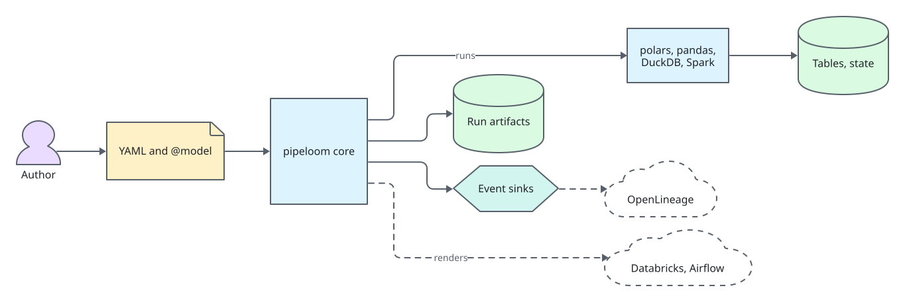

# pipeloom

Engine-agnostic data pipelines: Python models marked with @model, YAML for the project.

Models are Python functions marked with `@model`; YAML holds the project and the properties files that configure and describe them. pipeloom compiles them into an immutable plan. The same plan runs on pandas,
polars, PySpark, DuckDB or later engines, and runs locally, as one Databricks job, or as an Airflow DAG.
Every run produces a single event stream and artifacts you can query.

**Status: 1.3, stable.** From 1.0 the config, the plugin API, the artifact
schemas and the CLI are stable within the major version; see
[Stability and deprecations](docs/reference/stability.md). pipeloom discovers the `@model` functions of a project, validates it in
layers (YAML, schema, references, graph, plan semantics, engine capabilities, Python callables),
builds the dependency graph, compiles the execution plan into a manifest and runs it on polars,
pandas, DuckDB or Spark. It writes incremental models with a watermark, merge, replace_partitions and
scd2, checks contracts, applies schema-change policies and expectations with quarantine, runs
unit and data tests (`pipeloom test`, `pipeloom build`), and retries, times out and cancels
units. Every run writes `run_results.json`. The `pipeloom-databricks` and `pipeloom-airflow` plugins deploy a
project as a Databricks job or an Airflow DAG with one task per model. What comes next is in the
[roadmap](docs/roadmap.md).

```console
$ pip install "pipeloom[polars]"   # or pipeloom[pandas]
$ pipeloom init shop               # asks for the name and the engine
$ cd shop
$ pipeloom validate
$ pipeloom run
```

The optional extra `sqlglot` adds warnings for SQL that reads undeclared tables. Commands: `init`, `new model`, `validate`,
`compile`, `ls`, `graph` (with `--units` for orchestrators), `run`, `retry`, `test`, `build`, `runs ls`, `runs show`,
`finalize`, `explain`, `docs generate`, `docs serve`, `schema export` and `plugins list`; the `pipeloom-databricks`
plugin adds `databricks bundle`, `deploy`, `run` and `repair`. See the
[quickstart](https://emanuel-luis.github.io/pipeloom/latest/quickstart/) and the
[command line reference](https://emanuel-luis.github.io/pipeloom/latest/reference/cli/).

<picture>
  <source media="(prefers-color-scheme: dark)" srcset="docs/diagrams/context.dark.svg">
  <source media="(prefers-color-scheme: light)" srcset="docs/diagrams/context.light.svg">
  
</picture>

## Examples

[examples/](examples/README.md) has the same TPC-H pipeline (bronze, silver, gold) on polars,
pandas, Spark and Databricks, with a data generator.

## Goals

- Python models with a YAML project, layered validation and editor completion.
- An engine-agnostic core with one plugin per tool.
- End-to-end events and styled logs from one event stream.
- Persisted metadata for each run and each model.
- A Databricks renderer that produces one job per plan.
- A cosmos-style Airflow integration.
- Docs, CLI reference, JSON Schema and error catalog generated from code.
- Open-source hygiene from day one.

## Packages

Every distribution is released together and carries the same version.

| Distribution | Role |
|---|---|
| `pipeloom` | Core: config, validation, plan, scheduler, events, CLI |
| `pipeloom-polars` | polars engine |
| `pipeloom-pandas` | pandas engine |
| `pipeloom-duckdb` | DuckDB engine (SQL pushdown, database file catalog, Delta reads) |
| `pipeloom-spark` | PySpark engine (Delta and Spark Connect) |
| `pipeloom-databricks` | Databricks job renderer and runner |
| `pipeloom-airflow` | Airflow DAG integration |
| `pipeloom-openlineage` | OpenLineage event sink |

## Documentation

- [Documentation site](https://emanuel-luis.github.io/pipeloom/latest/): quickstart, running a pipeline, incremental models, write strategies, data quality, retries and cancellation, command line, JSON Schema, run artifacts and error codes
- [Roadmap](docs/roadmap.md) and [Market landscape](docs/landscape.md)
- [Architecture](docs/architecture.md)
- [Architecture decision records](docs/adr/README.md)
- [Diagrams](docs/diagrams/)

## Roadmap

| Version | Scope |
|---|---|
| 0.0.2 | Reserve the name, skeleton, CI, release, governance, architecture and ADRs |
| 0.1 | Config models, loader, validation layers, graph, selectors, plan, manifest, event bus; CLI `validate`, `compile`, `ls`, `graph`, `schema`, `plugins` |
| 0.2 | Scheduler, executors, polars and pandas engines, basic write strategies, state store, contract suite |
| 0.3 | Incremental, merge, replace_partitions, schema-change policy, expectations and quarantine, retries, timeouts, cancellation |
| 0.4 | Spark engine, run metrics, idempotent writes |
| 0.5 | Databricks renderer, deploy, run, repair |
| 0.6 | Airflow integration |
| 0.7 | Per-model catalogs, reproducible manifests (`compile --stable`) |
| 0.8 | `init`, `new model` and editor setup, `explain`, `state:modified` and `--defer`, `retry --from`, `docs generate` and `serve` |
| 0.9 | Python-first models (`@model`, `ctx.sql`), contracts, unit and data tests, `build`, SCD2, OpenLineage, run history and alerts, Airflow WATCHER mode |
| 1.0 | Stable config, plugin API (1, 0), published artifact schemas including the manifest, the orchestrator protocol and `graph --units`, the stability and deprecation policy |
| 1.1 | DuckDB engine (`pipeloom-duckdb`), conformance kit, portable models guide, `pipeloom demo`, Airflow 3.4 |
| 1.2 | Split checksums and `state:modified.<part>`, `plan --diff`, `pipeloom diff`, canonical dataset identity, machine-readable output and `AGENTS.md`, `ctx.sql` on pandas through DuckDB, docs overhaul |
| 1.3 (current) | Interval incrementals and ledger, `pipeloom backfill`, run outcome fields, `on_cursor_value_missing`, plugin API (1, 1) |
| 1.4 | Planned: partitions in artifacts, Airflow and Databricks updates, `pipeloom-dagster` |
| 1.5 | Planned: freshness, anomaly and reconcile checks, `--skip-unchanged`, schema contracts |
| 1.6 | Planned: column lineage, OpenLineage facets, OpenTelemetry sink |
| 1.7 | Planned: read layer, MCP server, `pipeloom ui` as 1.7.x |
| 1.8 | Planned: Delta without a cluster, Iceberg on Spark |
| 1.9 | Planned: language server and VS Code extension |

The decisions behind the plan are in section 6 of the [roadmap](docs/roadmap.md). Details per milestone are in the roadmap, and the market research behind it is in [Market landscape](docs/landscape.md).

## Contributing

See [CONTRIBUTING.md](CONTRIBUTING.md). Participation is governed by the
[Code of Conduct](CODE_OF_CONDUCT.md); security reports follow [SECURITY.md](SECURITY.md).

## License

Apache-2.0. See [LICENSE](LICENSE) and [NOTICE](NOTICE).

## Author

Emanuel Luis ([@emanuel-luis](https://github.com/emanuel-luis)).
