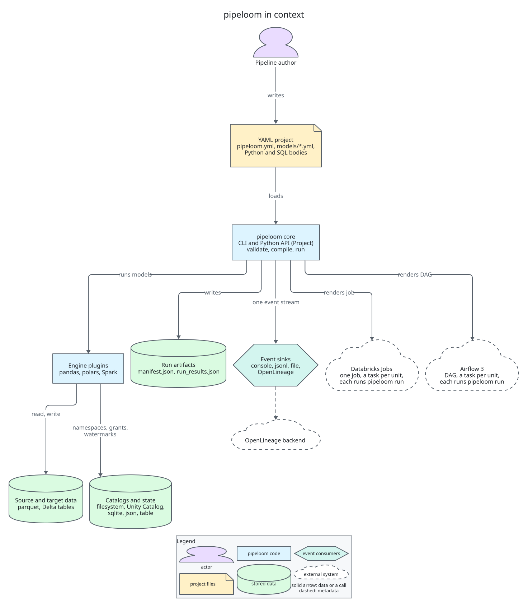

# pipeloom

Declarative, engine-agnostic data pipelines in YAML.

Pipelines are declared in YAML and compiled into an immutable plan. The same plan runs on pandas,
polars, PySpark or later engines, and runs locally, as one Databricks job, or as an Airflow DAG.
Every run produces a single event stream and artifacts you can query.

**Status: 0.3, alpha.** pipeloom reads a YAML project, validates it in layers (YAML, schema,
references, graph, plan semantics, engine capabilities, Python callables), builds the dependency
graph, compiles the execution plan into a manifest and runs it on polars or pandas. Tables are
written to a filesystem catalog (parquet, csv or ndjson), run state goes to a sqlite or json store,
and every run writes `run_results.json`. 0.3 adds incremental models with a
watermark, merge and replace_partitions writes, schema-change policies, and expectations with
quarantine, plus retries with backoff, per-attempt timeouts and graceful cancellation. Not yet:
Spark and the orchestrator integrations.

```console
$ pip install "pipeloom[polars]"   # or pipeloom[pandas]
$ pipeloom validate
$ pipeloom run
```

The optional extra `sqlglot` adds warnings for SQL that reads undeclared tables. Commands: `validate`,
`compile`, `run`, `ls`, `graph`, `schema export` and `plugins list`. See the
[quickstart](https://emanuel-luis.github.io/pipeloom/latest/quickstart/).



## Examples

[examples/](examples/README.md) has the same TPC-H pipeline (bronze, silver, gold) on polars,
pandas, Spark and Databricks, with a data generator.

## Goals

- Declarative YAML with layered validation and editor completion.
- An engine-agnostic core with one plugin per tool.
- End-to-end events and styled logs from one event stream.
- Persisted metadata for each run and each model.
- A Databricks renderer that produces one job per plan.
- A cosmos-style Airflow integration.
- Docs, CLI reference, JSON Schema and error catalog generated from code.
- Open-source hygiene from day one.

## Planned packages

`pipeloom`, `pipeloom-polars` and `pipeloom-pandas` are published with 0.3. The other rows are the
plan; a plugin name is published with its first functional release.

| Distribution | Role |
|---|---|
| `pipeloom` | Core: config, validation, plan, scheduler, events, CLI |
| `pipeloom-polars` | polars engine (published) |
| `pipeloom-pandas` | pandas engine (published) |
| `pipeloom-spark` | PySpark engine (Delta and Spark Connect) |
| `pipeloom-databricks` | Databricks job renderer and runner |
| `pipeloom-airflow` | Airflow DAG integration |
| `pipeloom-openlineage` | OpenLineage event sink |

## Documentation

- [Documentation site](https://emanuel-luis.github.io/pipeloom/latest/): quickstart, running a pipeline, incremental models, write strategies, data quality, retries and cancellation, command line, JSON Schema, run artifacts and error codes
- [Architecture](docs/architecture.md)
- [Architecture decision records](docs/adr/README.md)
- [Diagrams](docs/diagrams/)

## Roadmap

| Version | Scope |
|---|---|
| 0.0.2 | Reserve the name, skeleton, CI, release, governance, architecture and ADRs |
| 0.1 | Config models, loader, validation layers, graph, selectors, plan, manifest, event bus; CLI `validate`, `compile`, `ls`, `graph`, `schema`, `plugins` |
| 0.2 | Scheduler, executors, polars and pandas engines, basic write strategies, state store, contract suite |
| 0.3 | Incremental, merge, replace_partitions, schema-change policy, expectations and quarantine, retries, timeouts, cancellation |
| 0.4 | Spark engine, run metrics, idempotent writes |
| 0.5 | Databricks renderer, deploy, run, repair |
| 0.6 | Airflow integration |
| 0.7 (current) | Per-model catalogs, reproducible manifests (`compile --stable`) |
| 0.8 | OpenLineage, SCD2, deletes, `pipeloom retry` |
| 0.9 | Hardening, docs, API freeze candidates |
| 1.0 | Stable config, plugin API and artifact schemas |

## Contributing

See [CONTRIBUTING.md](CONTRIBUTING.md). Participation is governed by the
[Code of Conduct](CODE_OF_CONDUCT.md); security reports follow [SECURITY.md](SECURITY.md).

## License

Apache-2.0. See [LICENSE](LICENSE) and [NOTICE](NOTICE).

## Author

Emanuel Luis ([@emanuel-luis](https://github.com/emanuel-luis)).
