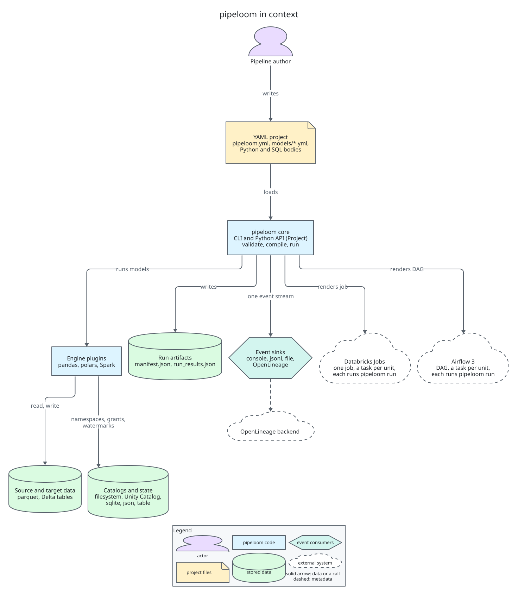
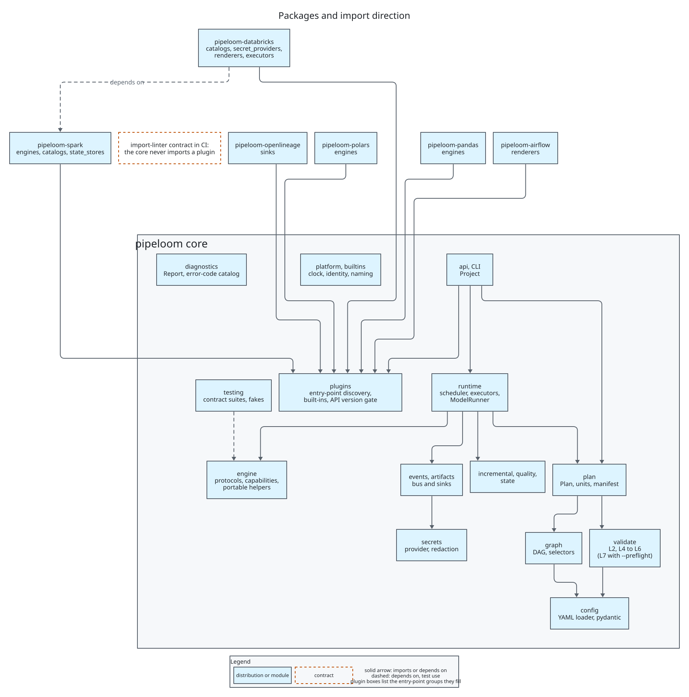
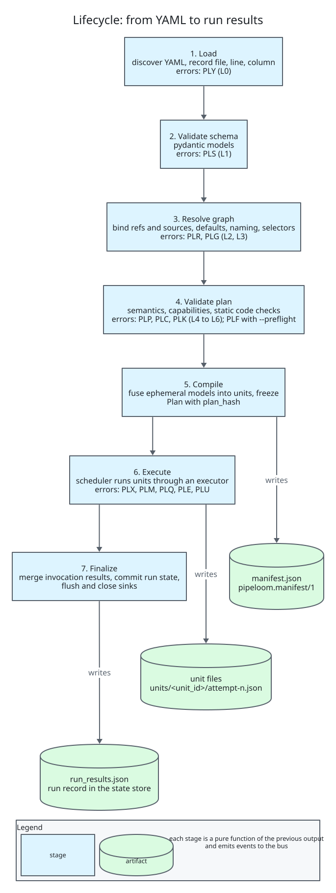
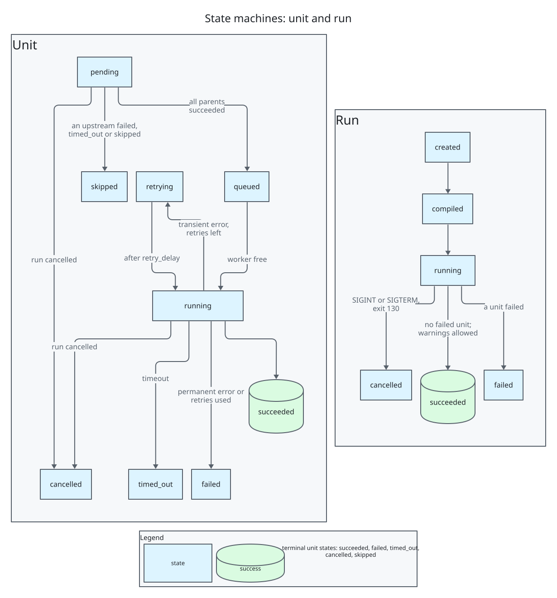
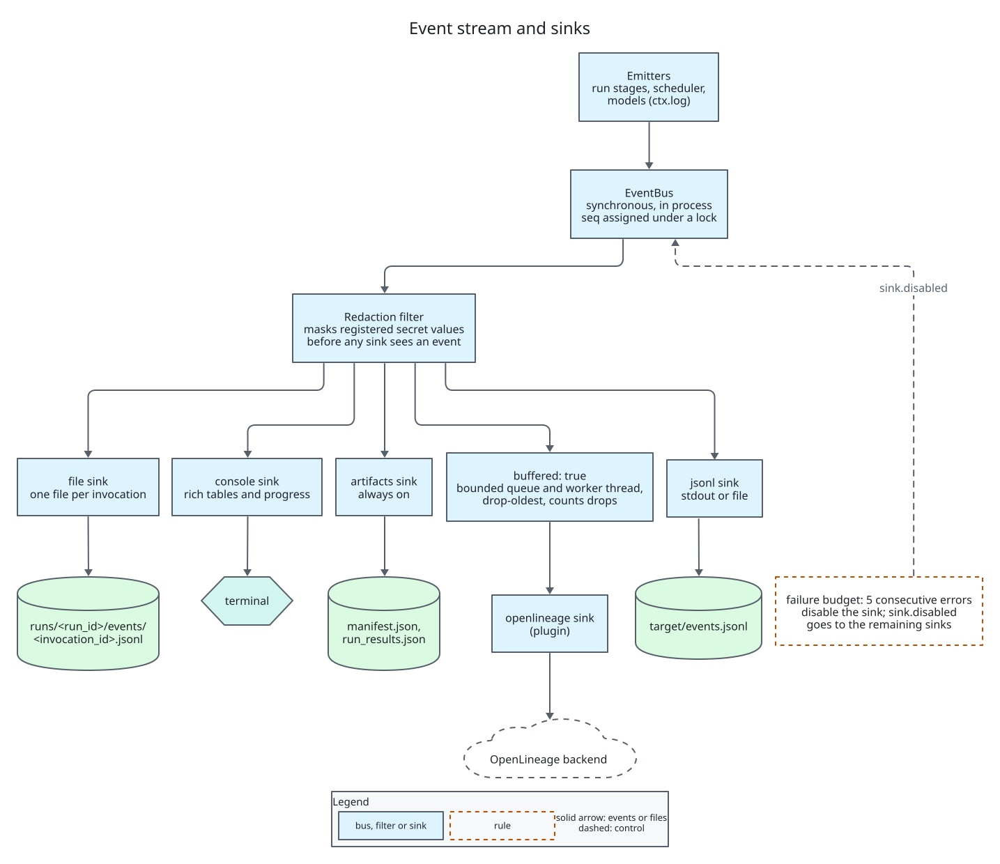
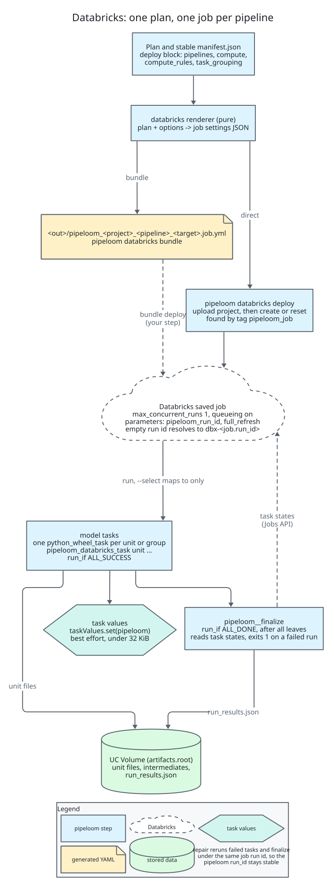
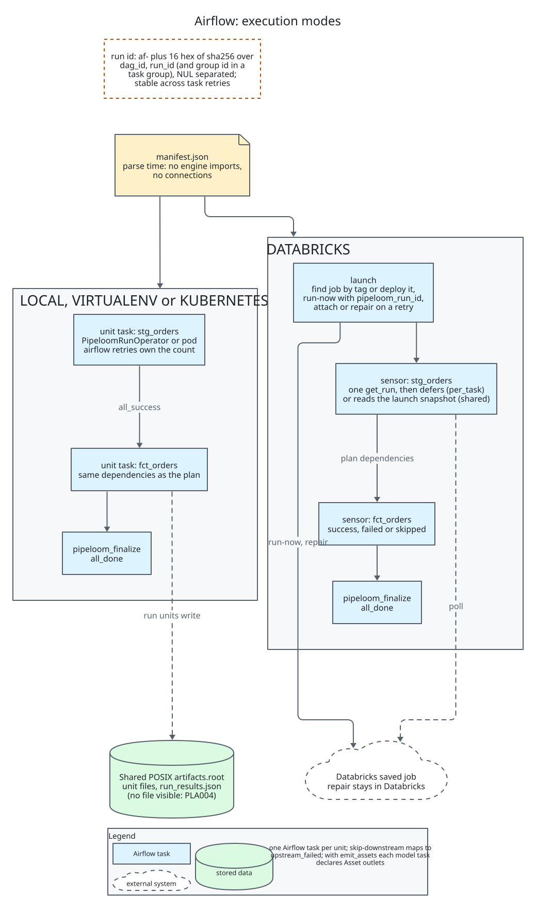

# pipeloom architecture

> **Status:** 0.4 implements everything up to 0.3 (the scheduler, the polars and pandas engines, incremental models, merge and replace_partitions, expectations and quarantine, retries, timeouts, cancellation) plus the `pipeloom-spark` engine with Delta writes, intermediates and the `table` state store. The Databricks and Airflow integrations are designed here and arrive in later versions (section 16).
> Decisions are recorded as ADRs in [adr/](adr/README.md). Diagrams are D2 sources in [diagrams/](diagrams/) with committed SVGs.

## 1. Vision, goals, non-goals, principles

**Vision.** A small, typed framework. Pipelines are declared in YAML and compiled into an immutable plan. That plan runs the same way on pandas, polars, PySpark or later engines, and runs locally, as one Databricks job, or as an Airflow DAG. Every run produces a single event stream and artifacts you can query.

**Goals:** declarative YAML with layered validation and editor completion; an engine-agnostic core with one plugin per tool; end-to-end events and styled logs; persisted metadata for each run and each model; a Databricks one-job renderer; a cosmos-style Airflow integration; open-source hygiene.

**Non-goals (through 1.0):** streaming; a scheduler service or UI; a portable SQL dialect; Jinja templating; running user code at compile time; Airflow 2 support.

**Principles. Each answers a lesson (L) from the concept spec.**
1. One event stream. Logs, metrics, artifacts and lineage subscribe to it (L1).
2. Dependencies are declared, never traced. Tracing is an opt-in static check that warns (L2).
3. No module-level registries. A `Project` object owns plugins and config (L3).
4. Docs, the CLI reference, the JSON Schema and the error catalog are all generated from code. Every CLI flag has a test (L4).
5. No session-global mutation. Every engine setting lives in a context manager with guaranteed cleanup. Metrics never depend on global commit tags (L5, L10).
6. Ready-queue scheduling with no level barriers (L6).
7. Execution units never share in-memory state. Ephemeral models are inlined; intermediates are persisted (L7).
8. Maintenance operations (compaction, clustering) run only when declared (L8).
9. Each declared write option is either applied by every strategy or rejected at validation (L9).
10. Platform behavior is injected: clock, identity, catalog, secrets (L11).
11. Incremental logic is a declared key plus a lookback, with a watermark store (L12).
12. Retries, timeouts, data quality, persisted metadata, selectors, schema-change policy, SCD2 and deletes are all first-class (L13).
13. YAML first, with JSON Schema (L14).

## 2. Glossary

- **Project:** a directory with `pipeloom.yml` and model files.
- **Model:** a named dataset built from declared inputs by a Python callable or a SQL body.
- **Source:** an external dataset declared in YAML.
- **Target:** a named runtime environment (engine, catalog, naming, state store).
- **Materialization:** `table`, `incremental`, `view`, `ephemeral` or `intermediate`.
- **Write strategy:** `append`, `overwrite`, `replace_partitions`, `merge` or `scd2`.
- **Plan:** an immutable compiled graph of resolved models.
- **Execution unit:** one schedulable node of the plan. It holds one persisted model plus any ephemeral models inlined into it.
- **Boundary:** `process` (all units in one process) or `task` (each unit in its own process or orchestrator task).
- **Manifest:** the serialized plan (`manifest.json`).
- **Run:** one execution of a plan, identified by `run_id`.
- **Invocation:** one process taking part in a run.
- **Attempt:** one try of a unit.
- **Watermark:** the high-water value of an incremental key.
- **Expectation:** a data-quality rule with `warn`, `drop` or `fail`.
- **Sink:** an event subscriber.
- **Renderer:** turns a plan into an orchestrator artifact.
- **Executor:** runs units.
- **Plugin API version:** the version of the protocol contract between the core and plugins.

## 3. Architecture overview



Source: [01-context.d2](diagrams/01-context.d2).

**Layers.** Arrows point toward dependencies. The core never imports a plugin, and an import-linter contract enforces this in CI.

```
CLI / Python API (pipeloom.api.Project)
  ├─ diagnostics  Diagnostic, Report, Outcome and the error-code catalog (`pipeloom.diagnostics.codes`); a leaf package
  ├─ platform   Clock and Identity seams
  ├─ config     YAML loader with line marks, pydantic models, defaults resolution, target binding, schema export
  ├─ validate   L2 references, L4 plan semantics, L5 capabilities, L6 static code (L0-L1 live in config, L3 in graph)
  ├─ graph      DAG, selectors, topological order, cycle paths
  ├─ plan       Plan, ExecutionUnit, Manifest, plan_hash
  ├─ runtime    Scheduler, Executor(thread|process), ModelRunner, ModelContext
  ├─ engine     protocols, logical types, capabilities, portable helpers (Narwhals)
  ├─ incremental / quality / state
  ├─ events     Event models, EventBus, console/jsonl/file sinks
  ├─ artifacts  manifest.json, run_results.json writers
  ├─ secrets    env provider, interpolation, redaction
  ├─ plugins    entry-point discovery, built-in table, API-version gate
  ├─ builtins   naming strategies, filesystem catalog spec, env secret provider
  └─ testing    contract suites, RecordingSink, FakeClock, MemoryEngine
Plugins: pipeloom-pandas | -polars | -spark (0.4) | planned: -databricks | -airflow | -openlineage
```

`pipeloom-spark` depends only on `pipeloom`. pyspark is not a dependency of it: the extra `local` brings `pyspark[connect]` and `delta-spark`, and `pipeloom[spark]` pulls `pipeloom-spark[local]` ([ADR-0031](adr/0031-spark-engine.md)). Databricks runtimes and Databricks Connect ship their own pyspark, so there the plugin is installed without extras.



Source: [02-packages.d2](diagrams/02-packages.d2).

**Lifecycle.** Each stage is a pure function from the previous stage's output. Every stage emits events.

1. **Load:** discover YAML files, then parse them while recording file, line and column for every node.
2. **Validate schema:** pydantic models (L0-L1).
3. **Resolve graph:** bind refs and sources, apply defaults and precedence, apply naming strategies to get physical names, apply selectors (L2-L3).
4. **Validate plan:** semantics, plugin capabilities and static code checks (L4-L6).
5. **Compile:** fuse ephemeral models into units for the chosen boundary, then freeze. Output is `Plan` plus `manifest.json` with a `plan_hash` (sha256 of the canonical JSON of nodes, sources, units, edges and the project, target, boundary and config version; selection, versions, timestamps and ids are excluded).
6. **Execute:** the scheduler runs units through an executor. Orchestrated tasks run `pipeloom run --manifest ... --select unit:<id> --expect-plan-hash <h>`.
7. **Finalize:** merge per-invocation results, write `run_results.json`, commit run state, flush and close sinks.



Source: [03-lifecycle.d2](diagrams/03-lifecycle.d2).

## 4. Configuration

**Project file.**

```yaml
# yaml-language-server: $schema=https://emanuel-luis.github.io/pipeloom/latest/schema/v1/project.json
config_version: 1
name: shop
model_paths: [models]
python_paths: [src]            # added to sys.path at execution only
vars: {country: BR}
defaults:
  models: {materialized: table, retries: 1, timeout: 30m}
targets:
  dev:
    engine: {kind: polars}
    catalog: {kind: filesystem, root: ./warehouse}
    naming: {kind: per_user}
    state: {kind: sqlite, path: .pipeloom/state.db}
    workers: 4
  prod:
    engine: {kind: spark}
    catalog: {kind: unity, catalog: main}
    naming: {kind: prefix, schema_prefix: prod_}
    state: {kind: table, table: ops._pipeloom_state}
    artifacts: {root: /Volumes/main/ops/pipeloom}
    deploy:                                  # 0.5: a plugin block, validated against `renderers`
      kind: databricks
      pipelines: {main: {}, daily: {select: ["tag:daily"]}}
      compute: {default: {kind: serverless, environment_version: "5"}}
      task_grouping: none
events:
  sinks:
    - {kind: console}
    - {kind: jsonl, path: target/events.jsonl, failure_budget: 5}
```

**Model files.** Any `*.yml` under `model_paths`.

```yaml
sources:
  - {name: raw_orders, format: parquet, location: data/raw/orders/}
models:
  - name: stg_orders
    sql: |
      select order_id, customer_id, amount, updated_at from raw_orders
    inputs: {raw_orders: {source: raw_orders}}
  - name: fct_orders
    python: shop.marts.orders:build          # module:function
    inputs:
      orders: {ref: stg_orders}
      customers: {ref: dim_customers}
    materialized: incremental
    incremental: {input: orders, column: updated_at, lookback: 2d}
    write: {strategy: merge, unique_key: [order_id], on_schema_change: append_new_columns}
    partition_by: [order_date]
    expectations:
      - {name: amount_non_negative, check: {range: {column: amount, min: 0}}, on_violation: drop}
    tags: [finance, daily]
```

`_defaults.yml` files set folder-level defaults. They cascade from the model's own folder up to its `model_paths` root, nearest first; mappings merge deeply, lists replace and `tags` is an ordered union without duplicates.

**ADR-0003: Model authoring.**
- Context: L2 and L14 require declared dependencies and YAML validation. Users still need a real transformation language.
- Options: YAML-only (too weak for transformations), YAML plus Python, YAML plus SQL, or YAML plus both.
- Choice: YAML declares every model. The body is either a Python callable or a SQL body. The `inputs` map binds local aliases to `ref` or `source`.
  - A Python callable is called as `build(ctx, **inputs)`. Each alias becomes a keyword argument holding a relation.
  - SQL refers to aliases as table names. The engine registers them as named relations for that query only.
  - At compile time pipeloom imports nothing from the project. L6 parses the callable's file with `ast` to check that the function exists and that its parameters equal `ctx` plus the input aliases.
  - Opt-in SQL table-reference checking via the sqlglot extra warns on mismatch.
- Consequences: graphs are cheap to build, so Airflow can parse DAG files safely. No Jinja. Reads of undeclared tables through `ctx.engine.native` are a documented escape hatch outside lineage.

**JSON Schema.** `pipeloom schema export --out schemas/` writes `project.json`, `models.json` and `defaults.json` (draft 2020-12) from the pydantic models.
- Plugin option models (engine, catalog, sink, state) are composed as `oneOf` branches on `kind`, using the plugins that are installed (`--plugins builtin` limits it to the built-ins).
- The docs site publishes the schemas of the built-in plugins under `latest/schema/v1/` (and under each version folder).
- The modeline above enables completion in editors that use yaml-language-server.

**Precedence.**
- Runtime settings (highest first): CLI flags; `PIPELOOM_*` environment variables (for example `PIPELOOM_TARGET`, `PIPELOOM_WORKERS`); an optional git-ignored user file `~/.pipeloom/profiles.yml` with per-target overrides; the `targets.<t>` block; then top-level project keys.
- Model config: the model entry; `_defaults.yml` files from the nearest folder up to the `model_paths` root; then `defaults.models`; then built-in defaults.
- Targets may change runtime keys only (engine options, catalog, naming, state, workers, artifacts, deploy). `deploy` is a runtime key like the others: the target block wins over the top-level one. The core validates its options with the `config_model` of the `renderers` plugin it names (the factory is never called), records them in the manifest as `metadata.deploy` (not part of the plan hash) and resolves nothing in them at runtime except `${secret:...}` references in plugin options. They may not change model semantics, so plans differ across targets only in physical names and runtime settings.
- Interpolation: `${env:NAME}`, `${env:NAME:-default}` and `${var:name}` resolve at compile time and are recorded in the manifest. `${secret:provider/path}` resolves only at runtime (section 14).

## 5. Core protocols

```python
from typing import Any, Protocol, Mapping, Sequence, Iterator, ContextManager
from dataclasses import dataclass
from datetime import datetime

@dataclass(frozen=True)
class Column: name: str; dtype: str; nullable: bool = True   # logical type: int64, decimal(18,2), timestamp[UTC]...
Schema = tuple[Column, ...]

@dataclass(frozen=True)
class Relation:                      # opaque handle; never inspected by core
    native: Any                      # pandas/polars frame, Spark DataFrame...
    engine: str
    lazy: bool

@dataclass(frozen=True)
class EngineCapabilities:
    formats: frozenset[str]; strategies: frozenset[str]
    sql_models: bool; views: bool; idempotent_writes: bool
    cancel: bool; bytes_metrics: bool; portable: bool   # Narwhals-compatible frames
    quality: bool                                       # evaluate and apply_drops (0.3)
    materializations: frozenset[str]                    # table, view, ephemeral (0.2)

@dataclass(frozen=True)
class StateStoreCapabilities: shared: bool              # visible to every process and task of a run

class Engine(Protocol):
    name: str
    version: str                                       # recorded as engine_version in run_results
    capabilities: EngineCapabilities
    def session(self, ctx: "RuntimeContext", *, catalog: "Catalog") -> ContextManager["EngineSession"]: ...  # one per invocation, thread-safe, cleanup guaranteed (L10)

class EngineSession(Protocol):
    native: Any                                        # escape hatch
    def reader(self, fmt: str) -> "Reader": ...
    def materializer(self, strategy: str) -> "Materializer": ...
    def sql(self, query: str, inputs: Mapping[str, Relation]) -> Relation: ...
    def schema(self, rel: Relation) -> Schema: ...
    def count(self, rel: Relation) -> int: ...
    def filter_since(self, rel: Relation, column: str, lower: Any, *, inclusive: bool = True) -> Relation: ...  # strict (>) when not inclusive
    def relation(self, native: Any) -> Relation: ...   # check a model's return value and wrap it; TypeError for a foreign type
    def persist(self, rel: Relation) -> Relation: ...  # in-memory copy for results shared by several units
    def create_view(self, target: "TargetRef", query: str, inputs: Mapping[str, "ReadSpec"]) -> "WriteResult": ...  # catalog view, never a session view
    def max_value(self, rel: Relation, column: str) -> Any: ...      # a plain Python value, never numpy or pandas
    def evaluate(self, rel: Relation, checks: Sequence["ExpectationSpec"]) -> "QualityCounts": ...  # raw counts; the core judges
    def apply_drops(self, rel: Relation, checks: Sequence["ExpectationSpec"], *, quarantine: "QuarantineMeta | None") -> "DropResult": ...
    def align(self, rel: Relation, schema: Schema) -> Relation: ...  # schema order, missing columns as typed nulls, cast
    def write_intermediate(self, rel: Relation, ref: "IntermediateRef", token: str) -> "WriteResult": ...  # overwrite at ref.location; a repeated token writes nothing (0.4)
    def applied_token(self, target: "TargetRef", token: str) -> "WriteResult | None": ...  # stored result with skipped=True
    def unit_scope(self, unit_id: str) -> ContextManager[None]: ...  # tags this thread's work so cancel can find it
    def is_transient(self, exc: BaseException) -> bool | None: ...   # True retryable, False permanent, None no opinion
    def cancel(self, unit_id: str) -> None: ...        # cooperative; no-op if not capable

class Reader(Protocol):
    def read(self, spec: "ReadSpec") -> Relation: ...            # source or upstream target
class Writer(Protocol):                                           # format-level primitive
    def write(self, rel: Relation, target: "TargetRef", mode: str, opts: "WriteOptions") -> None: ...

class Materializer(Protocol):                                     # one per strategy
    strategy: str
    def materialize(self, rel: Relation, target: "TargetRef", cfg: "WriteConfig",
                    token: str) -> "WriteResult": ...             # token = idempotency key; cfg.run_started_at = the run's start (the session opens before it is resolved)

class Catalog(Protocol):
    def exists(self, target: "TargetRef") -> bool: ...
    def ensure_namespace(self, ns: "Namespace") -> None: ...      # idempotent, cached per invocation
    def table_schema(self, target: "TargetRef") -> Schema | None: ...
    def apply_grants(self, target: "TargetRef", grants: Sequence["Grant"]) -> None: ...
    def maintain(self, target: "TargetRef", ops: Sequence["MaintenanceOp"]) -> None: ...  # explicit (L8)

class MetricsProvider(Protocol):                      # plugin-internal since 0.4: not part of the core API
    def before_write(self, target: "TargetRef") -> "MetricsToken": ...
    def after_write(self, target: "TargetRef", token: "MetricsToken", result: "WriteResult") -> "WriteMetrics": ...

class StateStore(Protocol):
    def get_watermark(self, key: "StateKey") -> "Watermark | None": ...
    def cas_watermark(self, key: "StateKey", expected: "Watermark | None", new: "Watermark") -> bool: ...
    def record_run(self, record: "RunRecord") -> None: ...           # insert or replace
    def get_run(self, run_id: str) -> "RunRecord | None": ...
    def record_unit(self, record: "UnitRecord") -> None: ...         # keyed by (run_id, unit_id, attempt)
    def list_units(self, run_id: str) -> tuple["UnitRecord", ...]: ...  # sorted by (unit_id, attempt)
    def lock(self, scope: str, run_id: str) -> ContextManager["LockInfo"]: ...  # non-blocking; raises LockHeld; 60 s lease renewed every 20 s
    def close(self) -> None: ...

class EventSink(Protocol):
    name: str
    def handle(self, event: "Event") -> None: ...
    def flush(self) -> None: ...
    def close(self) -> None: ...

class Renderer(Protocol):
    name: str
    def render(self, plan: "Plan", options: Mapping[str, Any]) -> Mapping[str, bytes]: ...  # path -> content
    # 0.5: the core only binds a renderer's options; it never builds one. The Databricks plugin
    # keeps rendering internal (`render_job`) and exposes `pipeloom_databricks.api`, so this
    # protocol stays a plugin-internal convention and is not called by the core.

class Executor(Protocol):
    name: str
    boundary: str                                    # "process" | "task"
    def submit(self, unit_id: str, *, queued_at: float) -> "UnitHandle": ...
    def wait_any(self, timeout: float | None) -> "UnitCompletion | None": ...  # None on timeout or wake
    def cancel(self, handle: "UnitHandle", reason: str, *, final: bool = False) -> bool: ...  # timeout and final also abandon the unit
    def has_terminal_event(self, handle: "UnitHandle") -> bool: ...  # a child process already emitted its own
    def wake(self) -> None: ...                      # unblocks wait_any; safe from a signal handler
    def shutdown(self, *, wait: bool) -> None: ...

class Clock(Protocol):
    def now(self) -> datetime: ...                   # timezone-aware UTC
    def monotonic(self) -> float: ...

class IdentityProvider(Protocol):
    def current(self) -> "Identity": ...             # user, host, orchestrator, orchestrator ids

class SecretProvider(Protocol):
    def resolve(self, path: str) -> str: ...
```

The engine protocols above omit `Writer`, `Catalog.apply_grants` and `Catalog.maintain`; they arrive with the versions that need them (section 16). `MetricsProvider` is shown for the shape of the `before_write` and `after_write` pair; with one implementation, the Spark engine's `DeltaMetrics`, it stays plugin-internal in 0.4 and the core has no such protocol. `ReadSpec.format` accepts `"table"` to read a catalog table through `ReadSpec.table`. The plugin API is (0, 2) in 0.2 ([ADR-0021](adr/0021-plugin-api-0-2.md)) and (0, 3) in 0.3 ([ADR-0024](adr/0024-plugin-api-0-3.md)) and (0, 4) in 0.4 ([ADR-0030](adr/0030-plugin-api-0-4-and-intermediates.md)); while the major version is 0 a plugin must match exactly.

**0.3 contract additions.**
- `WriteConfig` carries `strategy`, `unique_key`, `partition_by`, `update_condition` (engine dialect; `source.` and `target.` qualifiers, a bare name means source), `deletes` (`DeleteSpec`), `columns` (the final schema, chosen by the core) and `commit_meta`.
- `WriteResult(rows_inserted, rows_updated, rows_deleted, rows_written, bytes_written, target_version, skipped, commit_meta)`. `commit_meta` is stored with the idempotency token and returned on a replay, so a replayed write hands back the watermark and the quality summary of the original attempt.
- `evaluate` and `apply_drops` need the `quality` capability. Engines count and split rows; the core judges (section 10).
- `pipeloom.engine.errors`: `TransientError` (raise it to force a retryable failure), `CommitConflict` (a transient error for a table commit race) and `WriteKeyError` (PLM206).
- `pipeloom.engine.types` also holds `ColumnChange`, `SchemaDiff`, `ExpectationSpec`, `QualityCounts`, `QuarantineMeta`, `DropResult`, `can_widen` and `diff_schemas`.

**0.4 contract additions (plugin API (0, 4), [ADR-0030](adr/0030-plugin-api-0-4-and-intermediates.md)).**
- `RuntimeContext` gains `run_started_at` (timezone-aware UTC, the same in every invocation of a run) and `artifacts_root` (absolute POSIX path or URI). The engine session opens before any state-store call and before the run lock, so it has no `run_started_at`; the core passes it in `WriteConfig.run_started_at` and `IntermediateRef.run_started_at`.
- `EngineSession.write_intermediate(rel, ref, token)` persists an `intermediate` model at `IntermediateRef.location`; `ReadSpec(format="intermediate", location=...)` reads it back.
- `CatalogCapabilities(views=)` is static data on a catalog spec, so L5 can report PLC507 without importing the catalog.
- `unit_scope` spans a unit's reads, body, checks and write, because a lazy engine does its work at the write.
- `WriteRefusedError` is what an engine raises when its idempotency guard refuses a write; the core reports PLM207 (section 7).

**ADR-0002: Engine abstraction.**
- Context: the spec (section 4) lists coupling in the return type, reads, schema, temporary views, writes, merge, metrics and catalog SQL.
- Options:
  - (a) A hand-written protocol per plugin: full control, more code per engine.
  - (b) Narwhals as the core abstraction: it has no write, SQL or catalog API, and only lazy PySpark.
  - (c) Ibis: heavy, its write support is unverified, and it pushes users into an expression API.
  - (d) A hybrid.
- Choice: (d).
  - The core contract is the hand-written protocols above. Plugins own IO, writes, merge, catalogs, metrics and cancellation.
  - The core depends on Narwhals (it has no dependencies of its own) only for `pipeloom.engine.portable`. That module gives default `count`, `filter_since`, `max_value`, `schema` and `evaluate` that pandas, polars and PySpark plugins may reuse, through `narwhals.stable.v2`.
  - Model bodies receive native frames by default. `frame_api: narwhals` on a model passes Narwhals frames, so portable models work on any engine with `capabilities.portable`.
- Consequences: no lowest-common-denominator API for Spark users. Engines can override portable defaults for speed. Narwhals stays a replaceable implementation detail.

## 6. Plugin system and plugin API version

**ADR-0004: Discovery.**
- Options: entry points (stdlib `importlib.metadata`, the pytest model), pluggy (1:N hook fan-out), or a dbt-style namespace import.
- Choice: entry points. pipeloom picks one implementation per role by `kind`, which is 1-of-N selection, not hook fan-out, so pluggy adds a dependency without a matching need.

**Groups:**
- `pipeloom.engines`
- `pipeloom.catalogs`
- `pipeloom.state_stores`
- `pipeloom.sinks`
- `pipeloom.secret_providers`
- `pipeloom.executors`
- `pipeloom.renderers`
- `pipeloom.naming`
- `pipeloom.commands` (0.5, ADR-0034): a Click command or group that a plugin adds to the `pipeloom` CLI. `pipeloom plugins list --group commands` lists them from metadata; a command is imported only when invoked, built-in names win and a command that cannot be imported exits 1.

Each entry point resolves to a `PluginSpec(name, kind, api_version: tuple[int, int], factory, config_model, compatible_engines)`.

**Rules:**
- Discovery reads metadata only. A plugin is imported only when a config names its `kind`.
- `pipeloom plugins list` imports nothing.
- `PIPELOOM_DISABLE_PLUGIN_AUTOLOAD=1` restricts loading to `--plugin module:spec`.
- Duplicate `kind` names within a group are error PLU002.

**Plugin API version.** `pipeloom.plugins.API_VERSION = (MAJOR, MINOR)`, independent of the package version.
- MINOR covers additive changes: new optional protocol methods with defaults, new capabilities.
- MAJOR covers breaking protocol changes.
- The core accepts plugins with the same MAJOR and MINOR ≤ its own. Otherwise it raises PLU001 naming the installed and required versions.
- Before 1.0 the API is `0.x` and any minor may break. Plugin API 1.0 ships with pipeloom 1.0.

## 7. Validation layers and error catalog

Each finding is a `Diagnostic(code, severity, message, hint, location{file,line,col,json_pointer}, context)`. Diagnostics serialize to JSON. The catalog lives in code (`pipeloom.diagnostics.codes`) and generates the docs page. Codes are never reused.

| Layer | Prefix | Examples |
|---|---|---|
| L0 parse | PLY | PLY001 YAML syntax, several documents or an alias bomb; PLY002 duplicate key; PLY003 not valid UTF-8; PLY004 project or model file missing or unreadable |
| L1 schema | PLS | PLS101 unknown field (with "did you mean"); PLS102 type mismatch; PLS103 unsupported `config_version`; PLS104 literal value in a secret-like field; PLS105 required field missing; PLS106 `${env:X}` unset or unknown `${var:x}`; PLS107 malformed interpolation; PLS108 exactly one of a set of fields required |
| L2 references | PLR | PLR201 unknown ref (fuzzy suggestion); PLR202 duplicate model name; PLR203 unknown source; PLR204 unknown target or plugin kind; PLR205 duplicate source; PLR206 a `model_paths` entry does not exist (warning); PLR207 no target selected |
| L3 graph | PLG | PLG301 cycle (prints the path); PLG302 self-reference; PLG303 selector matched nothing; PLG304 unknown selector method; PLG305 malformed selector; PLG306 `unit:` selector names an unknown unit (0.2) |
| L4 plan semantics | PLP | PLP401 merge or scd2 without `unique_key`; PLP402 incremental without `column`; PLP403 aggregate expectation with `drop`; PLP404 `incremental.input` not in `inputs`; PLP405 write option not applied by this strategy (L9); PLP406 ephemeral fan-out above threshold (warning); PLP407 `replace_partitions` without `partition_by`; PLP408 ephemeral model with no consumer (warning); PLP409 a view needs a SQL model with no inlined ephemerals (0.2); PLP410 append with a lookback above zero reloads rows (warning, 0.3); PLP411 expectations on a view or ephemeral model (0.3); PLP412 `<model>__quarantine` is also a model in the same schema (0.3); PLP413 an `intermediate` model with `incremental`, a strategy other than overwrite, or `partition_by` (0.4) |
| L5 capability | PLC | PLC501 strategy unsupported by engine; PLC502 SQL model on an engine without SQL; PLC503 `boundary: task` with a non-shared state store (0.2); PLC504 catalog incompatible with engine; PLC505 non-idempotent append with retries > 0; PLC506 source format unsupported; PLC507 view without catalog views; PLC508 `frame_api: narwhals` without a portable engine; PLC509 materialization unsupported by the engine (0.3: the memory, polars and pandas engines accept `incremental`; 0.4: they and the Spark engine accept `intermediate`); PLC510 expectations on an engine without the `quality` capability (0.3) |
| L6 static code | PLK | PLK601 callable file or function not found; PLK602 parameters do not match inputs; PLK603 SQL references undeclared table (warning, active when the `sqlglot` extra is installed, 0.2); PLK604 callable name bound by something other than a def (warning); PLK605 SQL not parseable for that check (warning, 0.2) |
| L7 preflight (opt-in, connects) | PLF | PLF701 engine unreachable; PLF702 source missing; PLF703 target schema drift detected |
| Runtime | PLX, PLM, PLQ, PLE, PLU | PLX101 model raised; PLX102 timeout; PLX103 plan-hash mismatch; PLX104 cancelled; PLM201 write failed; PLM202 schema change rejected; PLM203 watermark CAS conflict (data already written; permanent); PLM205 watermark unusable (missing column, family mismatch or a lookback on a non-temporal column, 0.3); PLM206 write key invalid (missing key column or duplicate merge key, 0.3); PLM207 write refused by the idempotency guard: the engine skipped it because the model already has a later transaction version, nothing was written, permanent (0.4); PLQ301 expectation failed or `max_drop_ratio` exceeded; PLQ302 expectation names an unknown column or an `expr` the engine rejects (0.3); PLE401 sink disabled; PLU001 plugin API mismatch; PLU002 duplicate plugin kind; PLU003 plugin failed to load; PLX105 run lock held (0.2); PLX106 unit process exited without a result (0.2); PLX107 manifest invalid (0.2); PLM204 input read failed (0.2); PLX109 a `${secret:provider/path}` reference could not be resolved (0.5) |
| Renderers | PLD, PLA | PLD001 job above 1,000 tasks including finalize; PLD002 reserved, never emitted (`runs/submit` shares the 1,000-task limit); PLD003 task groups form a cycle; PLD004 invalid deploy options; PLD005 compute rule matches no model (warning); PLD006 two jobs carry one `pipeloom_job` tag; PLD007 job or run not found; PLD008 deployed job out of date; PLD009 Databricks API request failed; PLD010 no connection configured; PLD011 task ended without a unit result; PLD012 project file cannot be uploaded; PLD013 dynamic value reference not resolved; PLD014 run still active; PLD015 partly selected task group runs whole (warning); PLA001 unsupported execution mode, or its extra is missing (0.6); PLA002 invalid Airflow plugin configuration (0.6); PLA003 selection renders no unit (warning, 0.6); PLA004 unit task ended without a visible unit result (0.6); PLA005 unsupported Airflow version (0.6); PLA006 PROJECT compile cache unusable (warning, 0.6); PLA007 target boundary is not `task` (warning, 0.6) |

**Commands:**
- `pipeloom validate` runs L0-L6.
- `--preflight` adds L7.
- Exit codes: 0 means OK, 1 means errors, 2 means usage error, 130 means interrupted.

## 8. Execution and scheduler

**ADR-0006: Scheduler.** A ready-queue scheduler with no level barrier (L6).
- When a unit reaches a terminal state, each child's count of pending parents goes down by one. A child whose count reaches zero is enqueued.
- Ready units are ordered by descending count of downstream units, then by name, which is deterministic.
- `workers` caps concurrency. `pool` tags (a later milestone) cap per-resource concurrency.

**Unit state machine.**

```
pending → queued → running → succeeded | failed | timed_out | cancelled
                    running → retrying → running
pending → skipped   (an upstream is failed, timed_out or skipped)
queued  → skipped   (fail_fast stopped the run)
pending → cancelled (run cancelled)
queued  → cancelled (run cancelled)
```

The transition table is checked in code (`pipeloom.runtime.states`). `retrying -> cancelled` is part of it: a stop request, or fail-fast, cancels a unit that waits for its next attempt. A skipped unit carries a reason: `upstream_failed` (with the failed upstream) or `fail_fast`; `pipeloom finalize` adds `not_run` for a unit with neither an attempt file nor an orchestrator state (ADR-0034).

**Run state machine:** `created → compiled → running → succeeded | failed | cancelled`. A run with warnings is still `succeeded`.



Source: [04-state-machines.d2](diagrams/04-state-machines.d2).

**Policies** (ADR-0029):
- **Retries:** `retries` (default 0), `retry_delay` (default 1s) and `retry_on` (`transient`, the default, or `any`). The scheduler keeps a retry heap and never sleeps: a failed attempt with retries left moves `running -> retrying`, emits `unit.retrying` and holds no worker slot while it waits. `pipeloom.runtime.retry.classify` decides the category, in this order: `TransientError` anywhere in the cause chain; the engine's `is_transient` opinion; `ConnectionError` or `TimeoutError` in the chain; in the read, write and state phases an `OSError` other than FileNotFoundError, PermissionError (a Windows sharing violation is transient), IsADirectoryError, NotADirectoryError and FileExistsError; PLX106 is transient. Everything else is permanent. PLQ301, PLQ302, PLM202, PLM203, PLM205, PLM206 and PLM207 are always permanent, so `retry_on: transient` never repeats them; `retry_on: any` retries every failed attempt and therefore repeats deterministic failures. PLC505 rejects retries on an append model whose engine has no idempotent writes.
- **Backoff:** with `n` the retry number and `base` the `retry_delay`, `d = min(max(base, 300 s), base * 2^(n-1))` and the wait is `d * (0.5 + 0.5 * u)`, where `u` comes from `random.Random(f"{run_id}:{unit_id}:{n}")`. Delays fall in [d/2, d] and are reproducible.
- **Retry ownership:** the owner of the schedule retries. `pipeloom run --select unit:...` runs with `retries=0`, so a child of the process executor and a unit run by an external orchestrator never retry inside; the orchestrator (or the parent scheduler) owns the retry and the attempt number.
- **Timeouts:** per-attempt `timeout`, never retried. A timed-out unit is `timed_out` (PLX102), its descendants are skipped and the run fails.
  - The thread executor runs one daemon thread per attempt. It cannot kill a thread: it sets the attempt's cancel token, calls `EngineSession.cancel(unit_id)` once, writes the `timed_out` attempt file itself and drops whatever the thread reports later. The runner checks the token before reading, after the body, before the write and around the quarantine write, never between the start of the table write and the end of the watermark swap. A thread that is still working can therefore still commit after the verdict; the first terminal attempt file wins (`write_json_once`), finalize lets a scheduler `timed_out` or `cancelled` verdict beat a later result and records `late_result: <status>` in `warnings[]`, and `run.completed` reports `abandoned_threads`.
  - The process executor starts each child in its own process group. The child enforces the timeout with its own thread executor; the parent's deadline is `timeout + cancel_grace`, after which it kills the child and everything it started (`killpg` on POSIX, `taskkill /T /F` on Windows, only while the child has not been reaped).
- **Cancellation:** the first SIGINT or SIGTERM (SIGINT or Ctrl+Break on Windows) asks for a graceful stop: nothing new starts, pending, queued and retrying units are cancelled, and running units are asked to stop and get `cancel_grace` (default 30 s; target setting `cancel_grace` and flag `--cancel-grace`) to finish. Units that finish in time keep their real result; the rest are marked `cancelled` (PLX104). The run emits one `run.cancel_requested`, ends `cancelled` and exits 130. A second signal is a hard stop that skips the grace and abandons live thread attempts; a third raises KeyboardInterrupt. `RunControl.request_stop` does the same from the API. A unit invocation (child process) handles the same signals and exits 130.
- **Cancel on Spark:** `unit_scope` adds one tag to the unit for the length of its reads, body, checks and write, and `cancel(unit_id)` interrupts the jobs that carry it: a session tag (`addTag`, `interruptTag`) on Spark Connect, a SparkContext job tag (`addJobTag`, `cancelJobsWithTag`) on classic Spark. Job groups are not used, since Connect has none. A job that has not started when the first interrupt arrives is not seen, so the engine repeats the interrupt for up to a minute or until the scope ends. Cancel stops Spark jobs, not Python code between jobs, and a Delta commit either completes or does not happen ([ADR-0031](adr/0031-spark-engine.md)).
- **Windows:** a graceful stop of a child is `CTRL_BREAK_EVENT` to its process group (`CTRL_C_EVENT` cannot target one), followed by a kill after `cancel_grace`. There are no job objects in 0.3: a grandchild of a child that exits on its own survives. On POSIX the executor sweeps the child's process group after it exits.
- **Failure isolation:** skip-downstream is the default. Independent branches continue. `--fail-fast` stops dequeuing after the first failure.
- **Concurrency guard:** `StateStore.lock("<project>/<target>", run_id)` blocks a second concurrent run on the same target (PLX105). The lock is a 60 s lease that a heartbeat thread renews every 20 s, so a crashed run frees it within a minute. `--no-lock` is the escape hatch. Unit mode (`--select unit:<id>`) takes no lock and does not finalize: the owning invocation does ([ADR-0020](adr/0020-execution-model-0-2.md)).

**ADR-0007: Data handoff.**
- Context: L7. With `boundary: task`, no in-memory or temporary-view handoff is possible.
- Options: persisted intermediates everywhere (simple, costs IO); inlining (free IO, recomputes); a hybrid.
- Choice: the hybrid, decided at compile time.
  - `ephemeral` models are inlined. Their bodies run inside each consuming unit. Under `boundary: process` the result is memoized per run, so it is computed once.
  - `intermediate` models are persisted to `<artifacts.root>/runs/<run_id>/intermediate/<model>` (a scratch schema the catalog provides is planned). Finalize deletes them after `intermediate_ttl` (section 11).
  - `view` creates a catalog view where the engine supports it, never a session view.
- Consequences: the same plan runs in one process or many. PLP406 warns when an ephemeral model fans out to more than `ephemeral_fanout_warn` (default 3) units and suggests `intermediate`.

## 9. Incremental processing, write strategies, schema change

**ADR-0008: Incremental and state.** A declared key plus a lookback (L12), with watermarks in a `StateStore`.

**Incremental config:**

```yaml
incremental: {input: orders, column: updated_at, lookback: 2d, watermark_source: state}  # or: target
```

**Algorithm per unit:**
1. Look up the idempotency token with `EngineSession.applied_token`. A write that already used it is replayed: no read, no body, no write; the stored `commit_meta` gives the schema fields, the quality outcome and the watermark, and the unit goes straight to step 6 (ADR-0027).
2. `is_incremental` is true when the materialization is `incremental`, the target exists, the run is not a full refresh, and a watermark exists. With `watermark_source: state` the watermark is `state.get_watermark(project, target, model)`; with no stored value and an existing target it is seeded from `max(column)` of the target (`watermark_seeded: target` in `warnings[]`). With `watermark_source: target` it is `max(column)` of the target and the state store is never written. The column's type family (timestamp with zone, timestamp without, date, integer, decimal, float, string) must match the stored one; a missing column or a mismatch is PLM205.
3. The input is filtered with `filter_since`. Without a lookback the bound is strict: `column > w`. With a lookback it is inclusive: `column >= w - lookback`, in seconds on timestamps and in whole days (rounded up) on dates; a lookback on any other family is PLM205. The body sees `ctx.is_incremental`, `ctx.watermark` and `ctx.lower_bound`, set only when the unit is incremental.
4. The batch maximum `m` is computed on the filtered input. The new watermark is `max(w, m)` when incremental (`m` may be empty or below `w` because of the lookback) and `m` otherwise; an empty first batch leaves the state alone.
5. Write, with the intended watermark in `WriteConfig.commit_meta`.
6. `cas_watermark(expected, new)`, where `expected` is the value read from state in step 2 (none when seeded); emit `state.watermark_committed`. A store treats a stored value equal to `new` and written by the same run as success, which covers a crash between the swap and the attempt file. Any other mismatch is PLM203: the data is already written, the unit fails, and the error is permanent.

The watermark is committed after the write, and a retry with the same token replays the stored value instead of reading the input again (ADR-0027). A crash between the two commits exactly the original batch's watermark on retry, even when new input arrived. Append is safe only when the engine has idempotent writes (otherwise PLC505 forbids retries).

**State stores:**
- `sqlite`: core, local, single host.
- `json`: core, a directory; atomic rename for local and volume paths.
- `table`: `pipeloom-spark`, shared. One Delta table, partitioned by `kind` (`watermark`, `run`, `unit`, `lock`), addressed by catalog name (`table`) or by path (`path`), exactly one of the two. A row is found by `(kind, key)`. Every insert or replace is one `MERGE INTO` whose source is a one-row DataFrame: the watermark compare-and-set and the lease lock are single statements, a lost race gives a clean false or `LockHeld`, and a Delta concurrent-modification error is retried up to 10 times with jitter. Renewal and release are filtered `UPDATE` and `DELETE`. Times come from the client clock. The store reuses the engine's session and stops only a session it built ([ADR-0033](adr/0033-delta-table-state-store.md)). `boundary: task` requires `table` or `json` on a shared path.

**Write strategies.** All return a `WriteResult` (section 5), with fields `None` when unknown. The strategy of a model that sets none is `default_strategy(materialized)`: append for `incremental`, overwrite otherwise.

| Strategy | Semantics | Full refresh |
|---|---|---|
| append | insert all rows | overwrite |
| overwrite | replace data and schema | same |
| replace_partitions | replace partitions present in the batch (`partition_by` required) | overwrite |
| merge | `unique_key` equality; optional `update_condition`; `deletes: {column, value, mode: hard|soft}`; a missing key column or a duplicate key in the batch is PLM206; rows with a null key never match | overwrite |
| scd2 | `unique_key`, `tracked_columns` (default all), columns `valid_from`, `valid_to`, `is_current`, row hash; deletes close the current row | rebuild |

A full refresh writes append, merge and replace_partitions as overwrite. A first build (the target does not exist) keeps its strategy, because into an absent table every strategy writes the same rows and merge still checks its key. On filesystem tables (ADR-0025) every strategy writes one part file per partition when `partition_by` is set; replace_partitions swaps whole files without reading the others, and a merge rewrites the whole table in 0.3 as read-modify-write under a commit lock and an expected version. SCD2 is planned (section 16).

**Idempotency:** each write receives `token = "<run_id>:<model>"`. Engines with transactional idempotency use it. Engines without it declare `idempotent_writes=False`.

**Delta mapping (`pipeloom-spark`, [ADR-0032](adr/0032-delta-writes-and-idempotency.md)).** All Delta statements are SQL text or DataFrameWriter options; no Spark conf is set, on any session.
- Token: `txnAppId` is `pipeloom/<project>/<model>` (suffix `#quarantine` or `#intermediate` for those writes), `txnVersion` is the run start in epoch milliseconds, and `userMetadata` is `{"pipeloom": {"v": 1, "token", "commit_meta", "result"?}}`.
- Check: before writing, `DESCRIBE HISTORY ... LIMIT 100` is scanned for the token, and a hit returns the stored result with `skipped=True`. When a write produced no commit carrying the token, the scan repeats (a racing attempt may have won), then the full history; a token found nowhere means Delta refused the write because a later `txnVersion` exists for this app id, and the engine raises `WriteRefusedError` (PLM207). A newer run, an overlapping run (`--no-lock`) or a host clock that ran behind trips the guard; `txn_guard: false` turns it off, leaving only the history check.
- MERGE and migration: Delta applies `txnAppId` to a MERGE only through session confs, which would leak into other units of the session, and a migration overwrite or `mergeSchema` commit runs before the guarded write. So with the guard on, a merge into an existing table, and any write that needs a migration, first makes an empty claim commit with the real `txnAppId`, `txnVersion` and `userMetadata` `{"pipeloom": {"v": 1, "claim": token}}`. It has no `token` key, so the token scan and the metrics ignore it. Delta refuses it when a later version exists, so PLM207 comes before any data or schema change for every strategy. Later commits of that write use the app id `<app>@<token>` with version 1, which still keeps two attempts of the same token from both committing. A SQL `MERGE INTO` is then followed by an empty append carrying the token and the stored result; re-running the MERGE with the same batch converges, so a crash between the commits is safe, and the retry finds its own claim. A claim is void once a later run of the same model has committed, so that retry gets PLM207 instead of merging over the later run's data ([ADR-0032](adr/0032-delta-writes-and-idempotency.md)).

| Strategy | Delta write |
|---|---|
| append | `mode("append")`; `mergeSchema` when the final columns add columns |
| overwrite | `mode("overwrite")` with `overwriteSchema`, so any schema policy result is accepted |
| replace_partitions | `replaceWhere` over the distinct partition tuples of the persisted batch (more than 10,000 tuples fails and recommends merge); works on physically partitioned and unpartitioned tables; an empty batch writes only the token commit |
| merge | the claim commit, SQL `MERGE INTO`, then the token commit; null keys never match and insert; soft deletes are counted and moved from updated to deleted; a merge into a missing table is the first load, an append |

The schema policy (above) is applied by the core; the engine maps its result. Added columns go in the write itself (`mergeSchema`); a merge first makes an empty `mergeSchema` append instead. Removed or widened columns first run one migration commit: the table is read, aligned to the final columns and overwritten with `overwriteSchema`, keeping its partitioning. A migration commit carries no `txn` options and no token, so it never counts in the metrics; with the guard on, the claim commit before it takes the write version.

**Schema-change policy (`on_schema_change`):**
- `fail` (default): any column added, removed or changed in type raises PLM202.
- `ignore`: the final schema is the target's. The batch is aligned to it: extra columns dropped, missing ones filled with nulls, values cast to the target types (a failed cast is PLM201).
- `append_new_columns`: the target's columns followed by the new ones, nullable, in batch order. Removed columns stay; a type change is PLM202.
- `sync_all_columns`: the batch's columns. A type change is accepted only when `can_widen(target, batch)` (wider integer, int to float64, float32 to float64, decimals that keep every digit, finer timestamp units with the same zone, null to anything); otherwise PLM202.

The core decides the final schema (`pipeloom.runtime.schema_policy.resolve_columns`) and passes it as `WriteConfig.columns`; the engine only aligns the batch with `EngineSession.align`. A batch that differs from the target only by a lossless widening of the target's type is cast up to the target's types under every policy.

Every non-empty diff emits `model.schema_changed` (`relation`, `policy`, `action`: applied, ignored, rejected or replaced, and `changes`) and is copied to `schema_changes[]` of the run results. The policy applies only to strategies that keep existing rows (append, merge, replace_partitions) on an existing target outside a full refresh; overwrite, a full refresh and a first build use the batch schema and report the diff as `replaced`. Tables read every committed file through the table's current schema (schema-on-read), so append and widening never rewrite old files. See ADR-0026.

Table properties, `partition_by`, clustering and grants are applied by every strategy or rejected (PLP405). Maintenance (`optimize`, `vacuum`, clustering changes) runs only from `maintenance:` blocks with an explicit schedule (`every_n_runs`), never by default (L8).

## 10. Data quality

**ADR-0009: Expectations.** DLT-style actions plus quarantine, evaluated after the transformation and before the write.

```yaml
expectations:
  - {name: id_not_null, check: {not_null: [order_id]}, on_violation: fail}
  - {name: status_known, check: {accepted_values: {column: status, values: [new, paid, shipped]}}, on_violation: drop}
  - {name: amount_ok, expr: "amount >= 0 and amount < 1e6", on_violation: warn}   # engine-dialect, non-portable
  - {name: unique_id, check: {unique: [order_id]}, on_violation: fail}            # aggregate
quality: {quarantine: true, max_drop_ratio: 0.05}
```

- **Row-level checks:** `not_null`, `accepted_values`, `range`, `regex`, `expr`. Allowed actions: warn, drop, fail.
- **Aggregate checks:** `unique`, `row_count {min,max}`, `freshness {column, max_age}`. Allowed actions: warn, fail; `drop` is PLP403. They see only the batch, after the drops; for an incremental model that is the new rows, not the table.
- **Engines count, the core judges** (ADR-0028). `EngineSession.evaluate` returns raw counts: the total, violating rows per row check, rows that violate at least one drop check, and aggregate values. `pipeloom.quality.judge` decides pass or fail, the drop ratio, PLQ301 and the events. A pure-Python reference (`pipeloom.testing.reference`) defines the semantics and the contract suite compares every engine with it. Unlike DLT, counts are kept on `fail` too.
- **Null and NaN semantics:** a null input passes every check except `not_null`; NaN counts as null; `range` bounds are inclusive; `regex` is an unanchored search and needs a string column; `accepted_values` compares exactly; `expr` true passes, null passes, false fails. `unique` counts rows minus distinct keys and ignores rows with a null key part. Freshness is `now - max(column)` computed by the core with the run's clock; a naive timestamp reads as UTC and an all-null column fails.
- **`expr` dialects:** polars takes a SQL expression for `pl.sql_expr`; pandas takes a restricted Python expression (names, literals, operators, `in` with a tuple; no calls, attributes or `@name`; anything else is PLQ302); the memory engine takes a sqlite expression. An `expr` never runs code.
- **Order:** row checks run on the full output; if a drop check failed the rows are split (`apply_drops`); aggregates then run on the kept rows (one `evaluate` call when nothing can drop). A lazy relation is persisted first (`cached: true` in the event).
- **Drop:** filters rows that fail any `drop` check. A failed `fail` check, or a drop ratio above `quality.max_drop_ratio`, fails the unit with PLQ301 before it writes; the counts are still recorded.
- **Quarantine:** dropped rows are appended to `<target>__quarantine` under the token `<run_id>:<model>#quarantine`, so a replay writes them once. The table has the model's columns plus `_pipeloom_run_id` (string), `_pipeloom_failed` (list of the failing drop-check names; JSON text in a string column on csv catalogs) and `_pipeloom_ts` (timestamp[us, UTC]). Its schema policy is `append_new_columns`.

## 11. Events, logs and run metadata

**ADR-0010: Events.** One typed stream (L1) and a synchronous in-process bus.

**Envelope (`pipeloom.event/1`):**
- `id` (uuid4 hex), `run_id`, `invocation_id`, `seq` (monotonic per invocation, assigned under the bus lock), `ts` (RFC 3339 UTC, microseconds), `type`, `level`, `unit_id`, `model`, `attempt`, `data` (typed payload), `context` (orchestrator ids).
- Cross-invocation ordering is by (`ts`, `invocation_id`, `seq`).

**Event types:**
- Run: `run.started`, `run.compiled` (plan summary), `run.cancel_requested`, `run.completed`.
- Unit: `unit.queued`, `unit.started`, `unit.retrying`, `unit.succeeded`, `unit.failed`, `unit.timed_out`, `unit.cancelled`, `unit.skipped`.
- Payloads added in 0.3 for control: `unit.retrying{attempt, next_attempt, delay_ms, error}` (warning; `attempt` is the one that failed); `unit.timed_out{timeout_s, attempt}`; `unit.cancelled{reason: cancel|timeout}`; `run.cancel_requested{signal, grace_s}` (`signal` is SIGINT, SIGTERM or SIGBREAK, or null for an API stop).
- Model: `model.input_read`, `model.quality_evaluated`, `model.schema_changed`, `model.written`, `model.log` (user `ctx.log`).
- State: `state.watermark_committed`.
- Payloads added in 0.3: `model.written` gains `skipped` (a replayed token); `model.quality_evaluated` carries `total_rows`, `results[]`, `rows_dropped`, `rows_quarantined`, `drop_ratio`, `cached` and `failures[]` (it is a warning when anything warned, dropped or failed); `model.schema_changed` carries `relation`, `policy`, `action` and `changes[]` (a warning when rejected); `state.watermark_committed` carries `column`, `dtype`, `before`, `after`, `source` and `seeded`.
- Other: `sink.disabled`, `artifact.written`, `diagnostic` (validation warnings).
- `run.completed` also carries `abandoned_threads`, the number of timed-out or cancelled unit threads that were still alive when the run ended (a thread cannot be killed; it ends with the process).
- `run.completed` carries the status, exit code, counts, totals, `failures[]` (one entry per failed unit with its diagnostic) and `artifacts[]` (POSIX paths of the files the run wrote), so the console prints the failure block and the artifacts line from it.

**Bus and sinks:**
- The bus fans out to sinks in the order they are configured.
- Each sink has a `failure_budget` (default 5 consecutive errors). When exhausted, the sink is disabled and `sink.disabled` goes to the remaining sinks.
- `buffered: true` wraps a sink in a bounded queue and worker thread for slow transports, with drop-oldest and a count of drops.
- A redaction filter masks registered secret values before any sink sees an event.
- Built-in sinks: `console`, `jsonl` (stdout or file), `file` (per-invocation event files under artifacts), `artifacts` (always on; builds the result files).
- `pipeloom-openlineage` maps units to OpenLineage jobs: `<project>.<model>`, with a parent run facet for the pipeline run, the error facet, and input and output datasets from the manifest. The output-statistics facet is used if available (unverified).
- `RecordingSink` in `pipeloom.testing` asserts ordered events.



Source: [05-events.d2](diagrams/05-events.d2).

**Console library: rich.** It provides styled tables, colors and live progress in one dependency. structlog would still need a renderer for those. JSON lines need only the stdlib.

**Sample console output (`--log-format text`):**

```
14:02:11 pipeloom 0.5.0 | project shop | target dev | engine polars | run 20261029T140211Z-7f3a9c
14:02:11 plan: 6 units (3 table, 2 incremental, 1 view; 1 ephemeral inlined) | workers 4
14:02:12 1/6 OK    stg_customers ......... table          1,204 rows    88 KB   0.41s
14:02:12 2/6 OK    stg_orders ............ table          9,812 rows   412 KB   0.77s
14:02:13 3/6 WARN  fct_orders ............ merge  +311 ~42 -0  1 expectation warned  1.12s
14:02:13 4/6 FAIL  fct_payments .......... append  PLX101 KeyError: 'amount'        0.20s
14:02:13 5/6 SKIP  rpt_revenue ........... upstream fct_payments failed
14:02:14 6/6 OK    dim_customers ......... table          1,204 rows            0.35s
14:02:14 finished in 2.9s | OK 3 | WARN 1 | FAIL 1 | SKIP 1 | rows written 12,573
         fct_payments  PLX101 model raised KeyError: 'amount'
                       hint: column missing in input 'payments' (ref stg_payments)
                       at src/shop/marts/payments.py:14 in build
14:02:14 artifacts: target/run_results.json, target/manifest.json, target/events.jsonl
```

Long engine (JVM) traces are trimmed to the first user frame and the root cause. The full trace goes to JSON events only.

**Per-model metadata (`run_results.results[]`):**
- Identity: `unique_id` (`model.<project>.<name>`), `unit_id`, `materialization`, `strategy`, `relation_name`.
- Status: `status`, `attempt`, `retries_used`.
- Timing: `started_at`, `ended_at`, `duration_ms`, `queue_wait_ms`.
- Rows: `rows_read{input: n|null}`, `rows_written`, `rows_inserted`, `rows_updated`, `rows_deleted`, `rows_dropped`, `rows_quarantined`.
- Bytes and version: `bytes_written`, `bytes_read` (null unless the engine reports it), `target_version`.
- Incremental: `watermark_before`, `watermark_after`, `is_incremental`, `full_refresh`.
- Schema: `schema_hash`, `schema_changes[]{kind, column, old, new, action}`.
- Quality: `expectations[]{name, kind, action, passed, failed, value}` (`passed` is null and `value` is set for aggregate checks), `warnings[]` (expectation warnings and `watermark_seeded: target`). A replayed unit restores them from the stored commit metadata.
- Error: `{code, category, message, hint, exception_type, trace_excerpt}`.
- Runtime: `engine`, `engine_version`, `executor`, `orchestrator_ids` (Databricks job, run and task run ids; Airflow dag, run, task and try as `airflow_dag_id`, `airflow_run_id`, `airflow_task_id` and `airflow_try_number`; filled from `--orchestrator-id`, ADR-0034), `idempotency_token`.

**Per-run metadata (`run_results.run`):**
- `run_id`, `parent_run_id`, `invocation_ids[]`, `project`, `target`, `plan_hash`, `selector`, `args`, `full_refresh`.
- `status`, `started_at`, `ended_at`, `duration_ms`, `counts{status: n}`, `totals{rows_written, bytes_written}`.
- `identity{user, host, orchestrator}`, `pipeloom_version`, `plugins{name: version}`, `python_version`, `git_sha` (if available), `exit_code`, `intermediate_ttl` (seconds; the TTL this run was finalized with, which other runs use to judge its intermediates) and `warnings[]` (run-level messages, such as `intermediate_cleanup_failed: <run_id>: <error>`).

**Metrics capture (L5):**
- `MetricsProvider.before_write` records the target version.
- `after_write` reads commit history for versions in (before, after] and sums operation metrics. In the Spark engine only the commits whose `userMetadata` token equals the write's own count, plus the newest MERGE commit for a merge (a SQL MERGE carries no token, so a concurrent MERGE on the same table can be mistaken for it in the metrics, never in the data). Migration commits carry no token and are not counted. Metrics are `rows_written`, `rows_inserted`, `rows_updated`, `rows_deleted`, `bytes_written` and `target_version`, each null when the commits do not report it.
- Engines without history count rows instead: `count` on eager frames, or the writer's return value.

**Artifacts.** Layout: `<artifacts.root>/runs/<run_id>/{manifest.json, run_results.json, events/<invocation_id>.jsonl, units/<unit_id>/attempt-<n>.json, logs/<unit_id>-attempt-<n>.log}`. `artifacts.root` defaults to `target`. An `intermediate` model's result lives under `runs/<run_id>/intermediate/<model>`. `artifacts.intermediate_ttl` (default 1d; 0 deletes the folder at the end of a succeeded run) governs it: finalize deletes the folders of other runs once expired, each judged by the TTL recorded in its own `run_results.json` (0 counts as one hour, since only a failed run is left with data) against its last activity, the newest modification time under its run folder. A run without results, or resumed after them (manifest newer than `run_results.json`), expires after `max(ttl, 1h)` idle. A deletion failure is a warning in `run.warnings`, never a run failure. Finalize copies the run's `manifest.json` and `run_results.json` to the root.
- `results[]` has one row per persisted model, sorted by unit id; an ephemeral model appears in `ephemeral_inlined` of the units that inline it. Every row has every key, and fields 0.2 does not fill are null or empty.
- `manifest.json` (`pipeloom.manifest/1`): `metadata{pipeloom_version, plugins, config_version, plan_hash, project, target, boundary, python_paths, vars, env_vars, generated_at, invocation_id}`, `nodes{unique_id: resolved config, body, inputs, relation, unit_ids, checksum}`, `sources`, `units{unit_id: [unique_ids]}`, `unit_parent_map{unit_id: [unit_ids]}`, `parent_map`, `child_map`, `selectors{select, exclude, selected}`.
  - `plan_hash` is the sha256 of the canonical JSON (sorted keys, no spaces) of `nodes`, `sources`, `units`, `unit_parent_map`, `parent_map`, `child_map` and `metadata` reduced to `project`, `target`, `boundary` and `config_version`. Selection, versions, timestamps and ids do not change it. A `per_user` naming strategy puts the user into the relations, so use `none` where the hash must match across machines.
  - A node `checksum` is the sha256 of its canonical config plus its body (the SQL text, or the callable and its file bytes), with CRLF read as LF.
- `run_results.json` (`pipeloom.run_results/1`): `metadata`, `args`, `run`, `results[]`.
- Finalize merges unit files and picks the latest attempt per unit. Run records also go to the state store for history.
- `pipeloom finalize --run-id ID` (0.5, ADR-0034) closes a run that an orchestrator drove unit by unit. A unit takes its attempt file, else the state given with `--unit-states` (`pipeloom.unit_states/1`: `skipped`, `cancelled`, `failed` or `excluded`), else it is `skipped` with the reason `not_run`, which does not fail the run; `excluded` drops the unit. `orchestrator_ids` come from `--orchestrator-id KEY=VALUE`. It exits 0, 1 or 130 and rewrites the same results when repeated.

## 12. The Databricks plugin

**`pipeloom-databricks`** depends on `pipeloom-spark` and `databricks-sdk` (`>=0.50,<1`). It provides the `unity` catalog, the `databricks` secret provider, the `databricks` renderer (the `deploy` block), the `pipeloom databricks` commands (`bundle`, `deploy`, `run`, `repair`), the task wrapper and task-value publishing. There is no `databricks` executor: ADR-0020 picks executors by boundary, and Databricks is an orchestrator. User guide: [Databricks plugin](plugins/databricks.md). Amended by ADR-0035 and ADR-0036; the sections below are the delivered design.



Source: [06-databricks.d2](diagrams/06-databricks.d2).

**ADR-0011 (amended by ADR-0035): Rendering.**

**Task type.** Each unit (or group) becomes one `python_wheel_task` that runs the plugin wrapper, not the core CLI:

```json
{"task_key": "fct_orders", "depends_on": [{"task_key": "stg_orders"}],
 "python_wheel_task": {"package_name": "pipeloom_databricks", "entry_point": "pipeloom_databricks_task",
   "parameters": ["unit", "--project-dir=<root>", "--manifest=<root>/<stable manifest>",
     "--target=prod", "--pipeline=main", "--unit=fct_orders", "--plan-hash=<h>",
     "--run-id={{job.parameters.pipeloom_run_id}}", "--full-refresh={{job.parameters.full_refresh}}",
     "--job-id={{job.id}}", "--job-run-id={{job.run_id}}", "--task-key={{task.name}}",
     "--task-run-id={{task.run_id}}", "--start-ms={{job.start_time.timestamp_ms}}"]},
 "environment_key": "pipeloom_default", "max_retries": 1, "min_retry_interval_millis": 60000,
 "timeout_seconds": 1800}
```

- The wrapper is a `[project.scripts]` entry plus a lazy function of the same name in the package, so both Databricks lookups find it. It resolves the run id (empty means `dbx-<job run id>`), turns `start_ms` into `--run-started-at`, rejects a parameter that still holds `{{` (PLD013), calls the core CLI in the same process so an active Spark session stays the active one, passes the Databricks ids as orchestrator ids and exits with the core's code. Values use `--opt=value` so an empty value stays one argument.
- Task keys use `[A-Za-z0-9_-]`, at most 100 characters (a long or colliding key gets `_` and 8 hex characters of the sha256 of the original). Groups are `tag_<tag>` or `dir_<folder>`.
- The project is either synced by a bundle or uploaded by `deploy`. `python_paths` are prepended at execution.
- Model tasks keep `run_if: ALL_SUCCESS`, which maps skip-downstream onto Databricks "upstream failed". Tasks are sorted by key, finalize last.

**Compute.**
- Default: serverless, with one `environments[]` entry per compute (`pipeloom_<compute>`) whose `spec.environment_version` defaults to "5" (Python 3.12; version 1 is below the floor) and whose `dependencies` pin `pipeloom`, `pipeloom-databricks` and every plugin in the plan at the recorded version (Spark without extras). `dependencies` can be set to install from elsewhere.
- Alternative: `kind: job_cluster` emits a shared `job_clusters[]` entry plus `libraries`, pinned from PyPI by default.
- Compute comes from the target's `compute_rules` (selectors, first match wins, then `default_compute`), not from a model key: compute is a runtime key (section 4). A rule that matches no model is PLD005.
- The Spark engine's `active` mode uses the existing session. When none is active and `DATABRICKS_RUNTIME_VERSION` is set (a wheel task starts without one), it attaches with `builder.getOrCreate()` and no conf, and never configures or stops that session.

**Job lifecycle.**
- The default is a saved job: `jobs/create`, or `reset` when it exists, found by the tag `pipeloom_job=<project>.<pipeline>.<target>` (name lookup first, then a scan of all jobs; two matches are PLD006). Saved jobs give run history, repair, `only`-subset runs and up to 1,000 tasks. Equal settings hashes make a deploy a no-op; `reset` overwrites edits made in the UI.
- Tags: `pipeloom_job`, `pipeloom_plan_hash`, `pipeloom_settings_hash` (sha256 of the canonical settings without that tag) and `pipeloom_version`; user tags merge and ours win.
- Job settings: `max_concurrent_runs: 1`, queueing enabled, `parameters` `pipeloom_run_id` (default empty) and `full_refresh` (default `false`). The deploy block's `settings` pass through, except the keys pipeloom owns (PLD004).
- `runs/submit` is used only with `pipeloom databricks run --ephemeral` (dev, serverless only). It shares the 1,000-task limit, so PLD002 is reserved and never emitted.

**Bundles and direct deploy.**
- `pipeloom databricks bundle --target prod --out resources/` writes, per pipeline, `pipeloom_<project>_<pipeline>_<target>.job.yml` and a stable manifest next to it. The output must lie inside the bundle; paths use `${workspace.file_path}`; `--check` lists stale files. `databricks bundle deploy` remains the user's step.
- `pipeloom databricks deploy` renders the same settings, uploads the project (content addressed, only `pipeloom.yml`, model files, `*.py` below `python_paths` and the stable manifest) to `<workspace_root>/<project>/<pipeline>/<target>/<hash>`, then creates or resets the job. A folder with the marker `_pipeloom/complete` is never uploaded again; the current folder and the two newest others are kept.
- A `load_resources` hook for Python bundle resources is on the roadmap.

**Run identity and metadata.**
- An empty `pipeloom_run_id` resolves to `dbx-<job run id>`. Repairs keep the same job run id, so the pipeloom `run_id` is stable and the attempt number increments.
- Each task writes its unit file to `artifacts.root` (a UC Volume path); this is the source of truth.
- After a unit task the wrapper calls `taskValues.set("pipeloom", {...})` with status, rows written, duration, target version, warnings and error code, dropping units from the end above 32 KiB (Databricks allows 48 KiB). Task values are documented for notebooks only, so this is best effort and never changes the exit code.
- A final task `pipeloom__finalize` depends on every leaf with `run_if: ALL_DONE`, one retry and a 1,800 s timeout. It reads task states from the Jobs API (best effort), gives them to `pipeloom finalize --unit-states` (EXCLUDED to excluded; UPSTREAM_* to skipped; CANCELED or TIMEDOUT to cancelled; FAILED to failed with PLD011) and writes `run_results.json`. A job run's result comes from its leaf tasks, so a succeeding finalize would hide a failure: finalize exits 1 when the run failed.

**Task limit.**
- `jobs/create`, `reset` and `runs/submit` allow up to 1,000 tasks including finalize.
- Above the limit the plan fails with PLD001, with the hint to set `task_grouping: by_tag | by_folder`. That fuses models into multi-model tasks, run with `--unit` selectors through the in-process scheduler; membership is recomputed from the shipped manifest, which keeps the parameters short. Grouping applies whenever it is set, so the job shape does not flip at the 1,001st model. Alternatively, split into separate pipelines by selector.
- No automatic job chaining before 1.0.

**Subset and reruns.**
- `pipeloom databricks run --select tag:x` resolves on the plan, maps units to task keys (groups deduplicated), adds finalize and calls `run-now` with `only`. A partly selected group runs whole (PLD015). With `--run-id`, the start carries `idempotency_token = sha256("<job_id>:<run_id>")`.
- `pipeloom databricks repair --run-id` reruns the tasks in FAILED, TIMEDOUT, CANCELED, UPSTREAM_FAILED, UPSTREAM_CANCELED or MAXIMUM_CONCURRENT_RUNS_REACHED plus finalize, with `latest_repair_id` from the run history. A run that is still active is PLD014.

**Unity Catalog and secrets.** The `unity` catalog subclasses the Spark session catalog (three-part backticked names, schema created only when absent). The `databricks` secret provider resolves `${secret:databricks/<scope>/<key>}` through the client with no profile; failures are PLX109. Connection order: `--profile`, a user-set `DATABRICKS_CONFIG_PROFILE`, `DATABRICKS_HOST` with credentials, runtime authentication, else PLD010 (ADR-0036).

## 13. The Airflow plugin

**`pipeloom-airflow`** supports Airflow 3.2 up to 4.0 (`apache-airflow>=3.2,<4`, installed through the `airflow` extra; the package has no hard Airflow dependency, see [ADR-0037](adr/0037-airflow-packaging-and-rendering.md)). It imports `from airflow.sdk import DAG, TaskGroup, BaseOperator, BaseSensorOperator, Asset`. Triggers come from the Airflow 3 trigger base (verify the module path per minor version).

```python
from pipeloom_airflow.config import ProjectConfig, RenderConfig, ExecutionConfig, ExecutionMode, LoadMode
from pipeloom_airflow.dag import PipeloomDag

shop_daily = PipeloomDag(
    dag_id="shop_daily", schedule="@daily", start_date=datetime(2026, 1, 1),
    project_config=ProjectConfig(project_dir="/opt/pipelines/shop", manifest_path="/opt/pipelines/shop/target/manifest.json"),
    target="prod",
    render_config=RenderConfig(load_method=LoadMode.MANIFEST, select=("tag:daily",), emit_assets=True),
    execution_config=ExecutionConfig(mode=ExecutionMode.DATABRICKS, databricks_conn_id="databricks_default"),
)
```

`PipeloomTaskGroup` takes the same configs inside an existing DAG. `ExecutionConfig` fields: `mode`, `project_dir` and `manifest_path` (where units execute, defaulting to `ProjectConfig`'s), `virtualenv_dir`, `kubernetes` (`KubernetesConfig(image, namespace, python, pod_kwargs)`), `env`, and the `databricks_*` fields: `conn_id`, `pipeline`, `ensure_job`, `poll`, `poll_interval`, `timeout` (the user guide, [Airflow](plugins/airflow.md), lists them with defaults). The package has extras `airflow`, `kubernetes` (adds the cncf-kubernetes provider `>=10.25,<11`) and `databricks` (adds `pipeloom-databricks`, not the Databricks provider).

**ADR-0012: Airflow rendering.**

**Load methods (parse time):**
- `MANIFEST` (recommended): reads a precompiled `manifest.json`.
- `PROJECT`: compiles YAML. This is safe because no user code runs (ADR-0003), and it is cached by a hash of the inputs.
- Neither imports engines or connects to anything.

**Execution modes:**
- `LOCAL`: `PipeloomRunOperator` per unit runs `pipeloom run --select unit:<id> --run-id <rid>` (with `--manifest` in MANIFEST mode, and always `--expect-plan-hash`) in a child process group.
- `VIRTUALENV`: the same, using a prebuilt venv path.
- `KUBERNETES`: `PipeloomKubernetesOperator`, a `KubernetesPodOperator` from the cncf provider extra with a user image. Never deferrable.
- `DATABRICKS`: described below.
- `DOCKER`: later (PLA001 in 0.6).

**Artifact store (ADR-0038).** The target's `artifacts.root` must be one shared POSIX directory for every unit task and the finalize task: any path under the LocalExecutor, NFS, EFS or SMB under Celery, a ReadWriteMany claim or a CSI mount (through `pod_kwargs`) on Kubernetes. fsspec is rejected for 0.6 because create-once files and atomic replace are not portable across its backends, and state stores and filesystem catalogs need shared storage anyway. A unit task that succeeded with no visible attempt file fails finalize with PLA004.

**Retries.**

| Mode | Retries owned by | Notes |
|---|---|---|
| LOCAL, VIRTUALENV | Airflow: model `retries` and `retry_delay` | A unit invocation never retries itself. Exit 2: no retry. Exit 130: retry. Exit 1: no retry when the terminal error is permanent and `retry_on` is `transient`. |
| KUBERNETES | Airflow, same counts | `retry_on` is not enforced: Airflow sees only the pod result. |
| DATABRICKS | Databricks task retries | Sensors have no retries; the launch retries twice and attaches to its run. |

**Shared behavior:**
- One Airflow task per unit. `group_by` only nests visual task groups (not in DATABRICKS mode). The cancel grace (SIGKILL delay, pod termination grace, execution timeout slack) is the core default of 30 s, because the manifest does not carry the target's `cancel_grace`.
- Trigger rule `all_success`, so skip-downstream maps to `upstream_failed`.
- A `pipeloom_finalize` task runs with `all_done`, reads the Airflow task states and exits 1 when the pipeloom run failed, so the DAG run fails.
- `rid` is `af-` plus 16 hex characters of sha256 of the NUL-separated dag_id, Airflow run_id and, inside a task group, the group id (ADR-0037), stable across task retries. A clear-and-rerun of failed tasks therefore continues the same pipeloom run.
- With `emit_assets`, each model task declares `Asset(uri=<target URI>)` outlets.



Source: [07-airflow-modes.d2](diagrams/07-airflow-modes.d2).

**Databricks mode.**
- Options: (a) `DatabricksWorkflowTaskGroup` with `DatabricksTaskOperator` children; (b) one `run-now` of the bundle-deployed job, with per-model status mirroring.
- Option (a) builds the job spec from Airflow operators at parse time. That duplicates the pipeloom renderer, forces job name `<dag_id>.<group_id>`, fixes `max_concurrent_runs=1`, and disables "Repair All Failed Tasks" on Airflow 3.
- Choice: (b). The plugin calls `pipeloom_databricks.api` (stable since 0.5): `find_job`, `deploy` (as `ensure_job`), `run_job`, `find_run`, `repair`, `task_states` and `task_key_map`, with the `DatabricksClient` protocol and `FakeDatabricks` for tests.
  - A `launch` task (`PipeloomDatabricksRunOperator`) finds the job by tag, or deploys it at run time with `databricks_ensure_job` (PLD007 or PLD008 otherwise). It calls `run-now` with `job_parameters {pipeloom_run_id: rid}` and pushes the Databricks run id to XCom. It compiles the project on the worker and checks the plan hash (PLX103).
  - If a Databricks run already exists for `rid`, it attaches to it, or repairs it when tasks failed (for example after a cleared `launch`), recording each rerun task's attempt count as a baseline.
  - Each model gets a `PipeloomDatabricksTaskSensor` that mirrors the task state of its `task_key`: success, failed (`AirflowFailException` with the Databricks task message and the run page URL), or skipped (`AirflowSkipException` for upstream-failed or excluded tasks). A last sensor on the job's finalize task, trigger rule `all_done`, is `pipeloom_finalize`.
  - The sensors keep the plan's dependencies, so the Airflow graph is the pipeline graph.
  - Poll modes (ADR-0039). `per_task` (default): the launch returns after run-now or repair, each sensor makes one `get_run` call and defers on its own `DatabricksRunTrigger` without a verdict. `shared`: the launch defers on one whole-run trigger and the sensors read its final snapshot from XCom, with no call. Every deferral is bounded by `databricks_timeout` (default 24 hours).
- Consequences: one job definition whether the run is triggered by Airflow, the Databricks UI or the CLI, and repair stays in Databricks. Reruns go through `launch`. Polling load in `per_task` is one call per waiting sensor per interval; `shared` is one call per interval but results show only when the run is over.

## 14. Security and secrets

- Secrets never appear as literals in YAML. Fields whose names match secret patterns accept only `${secret:...}` or `${env:...}` (PLS104).
- `${secret:<provider>/<path>}` resolves at runtime inside the executing process through the `pipeloom.secret_providers` group. Providers: `env` (core), `file` (core, mode-checked), `databricks` (secret scopes, `${secret:databricks/<scope>/<key>}`, 0.5), `airflow` (connections and variables; later, no plugin registers it yet). A reference that cannot be resolved is PLX109, naming the path and never the value.
- Connections. Airflow DATABRICKS mode maps the Airflow connection itself (host; token in the password or `extra.token`; `extra.service_principal_oauth` with the client id as login) and builds the client with `pipeloom_databricks.api.connect_explicit`, so no profile, `~/.databrickscfg` or worker `DATABRICKS_*` variable changes the authentication. Errors name the connection id, never a value (PLD010); secrets pass through Airflow's `mask_secret` and a trigger serializes only the connection id (ADR-0039). The PROJECT compile cache stores a sha256 fingerprint of each environment variable the plan read, never its value (ADR-0037).
- The manifest, events and artifacts store only the references. Resolved values are registered with the redaction filter.
- Discovery never imports plugins until a config names them. `PIPELOOM_DISABLE_PLUGIN_AUTOLOAD` exists for locked-down hosts.
- Supply chain:
  - Trusted publishing (OIDC) with PEP 740 attestations.
  - Actions pinned by commit SHA, with Dependabot updates.
  - No `pull_request_target` workflows.
  - Integration secrets only in protected environments, never for fork PRs.
  - Private vulnerability reporting through `SECURITY.md`.
- Grants are declared in YAML and applied by the catalog. pipeloom never escalates privileges.

## 15. Testing, CI, release, docs

**Tests:**
- Unit tests per package.
- Property tests (hypothesis) for the scheduler: random DAGs, injected failures and timeouts. Invariants: a unit starts only after all parents succeed; every unit reaches exactly one terminal state; no level barrier, checked with timed fakes.
- Golden tests for the manifest and diagnostics.
- CLI tests for every flag via `click.testing.CliRunner` (L4).
- A synthetic, deterministic "shop" dataset (customers, orders, payments) generated in `pipeloom.testing.data`.

**Engine contract suite (`pipeloom.testing.contract.EngineContract`).** Every engine plugin subclasses it with a factory fixture, and each test is skipped unless the matching capability is declared. It covers:
- read for each declared format;
- logical-type round trip;
- `sql` alias binding;
- each strategy, including merge deletes, SCD2 history and replace_partitions;
- the idempotent retry of each strategy with the same token;
- the schema-change policy matrix, and `align` (cells that write a changed schema are skipped unless the harness sets `schema_on_read`, meaning old files are read through the table's current schema);
- incremental `filter_since` (strict and inclusive bounds) and `max_value` types;
- `evaluate` counts and `apply_drops` against the reference;
- metrics fields that are non-null where declared;
- `cancel` stops long work;
- session cleanup restores settings (L10).

Catalog, state-store and sink contract suites follow the same pattern.

**Renderer tests:**
- Databricks: snapshot JSON and YAML, the limits, and task-key sanitizing.
- Airflow: DAG-bag parse with no network access, with a parse-time budget, and per-mode task graphs. Pure modules (configs, loading, rendering, argv, states) run on every matrix cell with no Airflow installed; a test proves `airflow` stays out of `sys.modules`.
  - The `airflow` CI job (Ubuntu) runs the Airflow-importing tests against the locked latest Airflow and against the 3.2.2 floor. Tests opt in with `PIPELOOM_TEST_AIRFLOW=1` and refuse to start unless `AIRFLOW_HOME` is a throwaway directory under the temporary directory, the database is a sqlite file under it, and no `AIRFLOW_CONN_*` or `AIRFLOW__SECRETS__*` variable is set.
  - DAG-bag parses run in a subprocess with an explicit environment, a socket audit hook that forbids connections, and a sqlite file that must never be created. Budgets: 2 seconds for the shop DAGs, 4 for Kubernetes, 8 for 500 units (Airflow parses the file before every task, so this is also task start-up cost).
- Live Databricks and Airflow tests run only in a manually dispatched workflow.
- Databricks (0.5, ADR-0036): the `databricks-live` workflow (`on: workflow_dispatch` only, protected environment `databricks-live`, `permissions: contents: read`, 60-minute timeout, no profile file) builds the wheels, uploads them to a volume, deploys `tests/fixtures/databricks_live` and prints `CHECK <fact> ok|failed` for the facts offline tests cannot confirm: dynamic references in wheel parameters, the empty run id default, `only` with an `ALL_DONE` finalize, `job.start_time` across repairs, files on `/Volumes`, a Spark session in a wheel task. It deletes what it created unless `keep_job` is set. No other workflow and no test reaches a workspace; the check logic is unit-tested against `FakeDatabricks`.

**CI:**
- ruff check and format; mypy `--strict`; pytest with coverage.
- Matrix: Python 3.11-3.14 on Ubuntu, Windows and macOS. Spark tests run in their own `spark` job on Ubuntu with Java 17: the plugin suite as a parallel matrix of three legs (classic contract, classic rest and Connect), because classic and Connect cannot share a Python process. They opt in through the test-only variable `PIPELOOM_TEST_SPARK=classic|connect` (and need pyspark importable, `java` on PATH and a non-Windows host; otherwise they skip). Tests that start a second JVM also need `PIPELOOM_TEST_SPARK_HEAVY=1`, which CI does not set ([ADR-0033](adr/0033-delta-table-state-store.md) explains why). The job runs on every PR with no path filter and is meant to become a required check after two green runs on main.
- `uv build` plus installing the wheel into a clean venv plus `pipeloom --version`.
- Docs build with `--strict` and D2 compile.

**Release (ADR-0016):**
- SemVer per distribution, with lockstep versions for first-party distributions during 0.x and one tag `vX.Y.Z`.
- The tag workflow checks that the tag equals the version, builds, then publishes to PyPI by trusted publishing through the protected `pypi` environment, then creates the GitHub release with notes from `CHANGELOG.md` (Keep a Changelog).
- `config_version`, the manifest and event schema versions, and the plugin API version are versioned separately.

**Docs:**
- mkdocs-material with mkdocstrings (API), mkdocs-click (CLI), generated error-code and JSON Schema pages, and D2-rendered SVGs.
- Versioned with mike on GitHub Pages.
- ADRs in `docs/adr/`.

## 16. Roadmap

- **0.0.2:** reserve the name; skeleton (section 18); CI, release, governance; this document and the ADRs.
- **0.1:** config models, loader with line marks, L0-L6, graph, selectors (`name`, `+name`, `name+`, `tag:`, `path:`, `materialized:`), plan, manifest, schema export, event bus with console and jsonl sinks. CLI: `validate`, `compile`, `ls`, `graph`, `schema`, `plugins`. A `MemoryEngine` for tests. Deferred to 0.2: PLC503 and PLK603, the `~/.pipeloom/profiles.yml` file, `PIPELOOM_*` variables beyond `PIPELOOM_TARGET`, `PIPELOOM_PROJECT_DIR` and `PIPELOOM_LOG_FORMAT`, and Narwhals support.
- **0.2:** scheduler, thread and process executors, `pipeloom-polars` and `pipeloom-pandas`, table/view/ephemeral, append and overwrite, sqlite and json state, run_results, the contract suite. pandas has no SQL models or views yet (PLC502, PLC507), so SQL on pandas is deferred. `incremental` and `intermediate` are rejected with PLC509 until their versions. PLK603 and PLK605 need the `sqlglot` extra.
- **0.3 (delivered):** incremental models with watermarks, merge and replace_partitions on filesystem tables (format /2), schema-change policies, expectations and quarantine, retries with backoff, per-attempt timeouts, graceful and hard cancellation, plugin API (0, 3). SCD2 and `intermediate` moved out of 0.3.
- **0.4 (delivered):** `pipeloom-spark` (local Spark, Spark Connect and an active session; the `delta_path` and `spark_catalog` catalogs), Delta writes with append, overwrite, merge and replace_partitions, idempotent writes through transaction ids and a token in the commit, metrics from commit history, expectations and quarantine on Spark, the `table` state store, `intermediate` materialization on every engine, `--run-started-at`, plugin API (0, 4). pyspark is an opt-in extra. SCD2 stays planned.
- **0.5 (delivered):** `pipeloom-databricks`: renderer, bundle YAML, direct deploy, run, repair, finalize with task states, task values, task grouping, compute rules, the `unity` catalog, the `databricks` secret provider and the manual live workflow. The core gained the `deploy` block, `pipeloom.commands`, `--orchestrator-id`, `pipeloom finalize` and runtime secret resolution (ADR-0034 to ADR-0036). Plugin API stays (0, 4).
- **0.6 (delivered):** `pipeloom-airflow`: LOCAL, VIRTUALENV, KUBERNETES and DATABRICKS modes (live `per_task` and `shared` polling), `PipeloomDag` and `PipeloomTaskGroup`, the PROJECT compile cache, `pipeloom finalize --unit-states-json`, `pipeloom_databricks.api.connect_explicit`, PLA001 to PLA007, the `airflow` CI job. Later: the DOCKER mode and an `airflow` secret provider (connections and variables); a `dag.test()` end-to-end test of DATABRICKS mode needs a file-backed Databricks fake or the live workflow.
- **0.7:** `pipeloom-openlineage`, SCD2, deletes, `pipeloom retry` (`result:fail+`), `state:modified`.
- **0.8-0.9:** hardening, performance, docs completeness, API freeze candidates, the deprecation policy.
- **1.0:** `config_version: 1`, plugin API 1.0, manifest, event and run_results schemas v1 all declared stable.

## 17. ADR list and diagrams

Each ADR is Context, Options, Choice, Consequences, as written in the sections above.

| ADR | Topic | Where |
|---|---|---|
| 0001 | Record architecture decisions | `docs/adr/` |
| 0002 | Engine abstraction: protocols plus Narwhals helpers | §5 |
| 0003 | Model authoring: YAML plus Python or SQL, declared inputs | §4 |
| 0004 | Plugin discovery via entry points; eight groups, a ninth (`pipeloom.commands`) in 0.5 | §6 |
| 0005 | Packaging (see below) | §17 |
| 0006 | Ready-queue scheduler | §8 |
| 0007 | Data handoff: execution units, inlining, intermediates | §8 |
| 0008 | Incremental key, watermark state, strategies | §9 |
| 0009 | Expectations and quarantine | §10 |
| 0010 | Events, sinks, artifacts; rich for the console | §11 |
| 0011 | Databricks job rendering (amended by 0035) | §12 |
| 0012 | Airflow rendering and modes | §13 |
| 0013 | Run identity, idempotency, reruns (see below) | §17 |
| 0014 | Secrets by reference | §14 |
| 0015 | Python ≥ 3.11; click CLI; pydantic v2; hatchling; mypy strict | §17 |
| 0016 | Versioning, release, plugin API version | §15 |
| 0034 | Core orchestration hooks (amends 0004, 0010, 0013, 0014) | §4, §6, §11 |
| 0035 | Databricks rendering and job lifecycle (amends 0011, 0012) | §12 |
| 0036 | Databricks client and connection | §12, §15 |

**ADR-0005: Packaging.**
- Options:
  - One distribution with extras. Its entry points are registered even when the extra's dependencies are missing, which leads to import errors at load. It also couples dependency bounds.
  - Separate distributions in separate repos: high overhead.
  - Separate `pipeloom-<plugin>` distributions in one uv workspace.
- Choice: the uv workspace. The core is distribution `pipeloom` at the repo root; plugins live in `plugins/pipeloom-<name>/` with import package `pipeloom_<name>` (no namespace packages).
- Convenience extras on `pipeloom` (for example `pipeloom[polars]`) just depend on the plugin distribution.
- PyPI now: publish `pipeloom` 0.0.2 only. Plugin names get published with their first functional release, which avoids PEP 541 placeholder squatting.
- Pending trusted publishers may be registered for the plugin names. Assumption: a pending publisher does not reserve a name; verify.
- `[tool.uv.workspace]` is added in 0.2 with the first plugin (whether uv accepts an empty members glob is unverified).

**ADR-0013: Run identity.**
- `run_id` is either caller-supplied or generated as `YYYYMMDDTHHMMSSZ-<6 hex>`, matching `[A-Za-z0-9._-]{1,64}`.
- Orchestrators derive it deterministically: `dbx-<job_run_id>` or `af-<hash>`.
- Orchestrator retries and repairs keep the `run_id` and increment the `attempt`.
- Local `pipeloom retry --from <run_id>` creates a new run with `parent_run_id`, selecting `result:fail+` (failed units plus their skipped descendants).
- Writes are idempotent through the token `<run_id>:<model>`.

**ADR-0015: Python version.** Python 3.10 reaches end of life in October 2026, so the floor is 3.11.

**D2 diagrams (`docs/diagrams/`):**
1. `01-context.d2`: users, YAML project, CLI and API, engines, catalogs, orchestrators, event consumers.
2. `02-packages.d2`: distributions, core modules, import direction, the entry-point groups each plugin fills.
3. `03-lifecycle.d2`: load → validate → resolve → validate plan → compile → execute → finalize, with the artifacts and error prefixes of each stage.
4. `04-state-machines.d2`: unit and run state machines, including retry, timeout, skip and cancel transitions.
5. `05-events.d2`: event bus fan-out to sinks, redaction, failure budget, buffered sinks, the artifact writer.
6. `06-databricks.d2`: plan → job settings or bundle YAML; tasks, finalize, run-id propagation, artifacts on the volume, task values.
7. `07-airflow-modes.d2`: PipeloomDag in LOCAL, VIRTUALENV or KUBERNETES mode (one task per unit, shared artifact root) versus DATABRICKS mode (launch, mirror sensors, repair path).

## 18. Package skeleton for now

```
pipeloom/
├── .github/
│   ├── workflows/ci.yml            # ruff, mypy --strict, pytest matrix (3.11-3.14 on Ubuntu, Windows and macOS), uv build + wheel smoke, docs --strict, d2 compile
│   ├── workflows/release.yml       # on tag v*: verify tag==version, uv build, one PyPI publish job per distribution (env pypi or pypi-<plugin>), GitHub release
│   ├── workflows/docs.yml          # mkdocs + mike deploy on main and tags
│   ├── dependabot.yml              # ecosystems: uv, github-actions; weekly; grouped
│   ├── CODEOWNERS
│   ├── pull_request_template.md
│   └── ISSUE_TEMPLATE/{bug_report.yml, feature_request.yml, config.yml}
├── docs/
│   ├── index.md
│   ├── architecture.md
│   ├── adr/README.md               # index + status table
│   ├── adr/0000-template.md
│   ├── adr/0001-record-architecture-decisions.md … 0016-versioning-and-plugin-api.md
│   └── diagrams/01-context.d2 … 07-airflow-modes.d2
├── src/pipeloom/
│   ├── __init__.py                 # __version__ = importlib.metadata.version("pipeloom")
│   ├── __main__.py                 # from pipeloom.cli import main; main()
│   ├── cli.py                      # @click.group() + @click.version_option(package_name="pipeloom", prog_name="pipeloom")
│   └── py.typed
├── tests/
│   ├── test_version.py             # __version__ equals installed metadata
│   └── test_cli.py                 # CliRunner: `--version` exit 0, output "pipeloom, version X"; `python -m pipeloom --version`
├── pyproject.toml                  # see below
├── uv.lock
├── mkdocs.yml
├── .pre-commit-config.yaml         # ruff, ruff-format, mypy, end-of-file, check-yaml
├── .editorconfig  .gitignore  .python-version (3.12)
├── README.md  LICENSE (Apache-2.0)  NOTICE
├── CONTRIBUTING.md                 # uv setup, DCO sign-off, ADR process, tests per flag
├── CODE_OF_CONDUCT.md              # Contributor Covenant 2.1
├── SECURITY.md                     # GitHub private vulnerability reporting, supported versions
├── GOVERNANCE.md                   # single-maintainer model, path to maintainers
└── CHANGELOG.md                    # Keep a Changelog; [0.0.2] entry
```

The core sits at the repo root so `README` and `LICENSE` ship in the distribution without copies.

**`pyproject.toml` essentials:**
- `[build-system] requires = ["hatchling"]`
- `[project]`:
  - `name = "pipeloom"`, `version = "0.0.2"`, `requires-python = ">=3.11"`
  - `license = "Apache-2.0"`, `license-files = ["LICENSE", "NOTICE"]`, `readme = "README.pypi.md"`
  - `dependencies = ["click>=8.1"]`
  - `[project.scripts] pipeloom = "pipeloom.cli:main"`
  - classifiers including `Typing :: Typed`
  - `authors`: to be filled by the maintainer
- `[dependency-groups]`: `dev = ["pytest", "pytest-cov", "mypy", "ruff", "pre-commit"]`, `docs = ["mkdocs-material", "mkdocstrings[python]", "mkdocs-click", "mike"]`
- Tool configs: `[tool.ruff]`, `[tool.mypy] strict = true`, `[tool.pytest.ini_options]`.

---

## Verification plan (for the skeleton commit)

- `uv sync && uv run pytest -q && uv run mypy --strict src && uv run ruff check`
- `uv build`, then install the wheel into a clean venv and run `pipeloom --version` and `python -m pipeloom --version`.
- `mkdocs build --strict`, and `d2` compile of all diagrams.
- The first tag, `v0.0.2`, is the real release: there is no TestPyPI dry run.

## Risks

- The orchestrator thread executor's timeouts are cooperative. Code that ignores cancellation keeps running until the process ends.
- In Airflow DATABRICKS mode the `per_task` sensors poll per model. Large DAGs need a longer poll interval or `databricks_poll="shared"`.
- Unverified facts are marked inline: serverless `environment_version`, the task-key length limit, whether pending publishers reserve names, pydantic's draft-2020-12 output, whether uv accepts an empty workspace, and the OpenLineage output-statistics facet. Verify each before implementing it.
- Narwhals stable-API drift: pinning to `stable.v2` limits it.
- Lockstep versioning means plugin-only fixes still bump every distribution during 0.x.

## Resolved defaults (2026-10-29)

1. Airflow 3 only (ADR-0012).
2. Only `pipeloom` is published now. Plugin names are published with their first functional release (ADR-0005).
3. Docs and JSON Schema URLs live at `https://emanuel-luis.github.io/pipeloom/`. The repo has been public since 2026-11-02.
4. DCO sign-off. The author and CODEOWNERS are Emanuel Luis. Security reports go through GitHub private vulnerability reporting or email.
5. The shared artifact store for the Airflow LOCAL and KUBERNETES modes: decided in 0.6 as one shared POSIX `artifacts.root` with a PLA004 sentinel; fsspec is deferred (ADR-0038).
6. CI runs Python 3.11 to 3.14 on Ubuntu, Windows and macOS. While the repo was private it ran one Windows and one macOS job on 3.12 only, because macOS minutes cost 10x; the full matrix came back when the repo went public on 2026-11-02.
