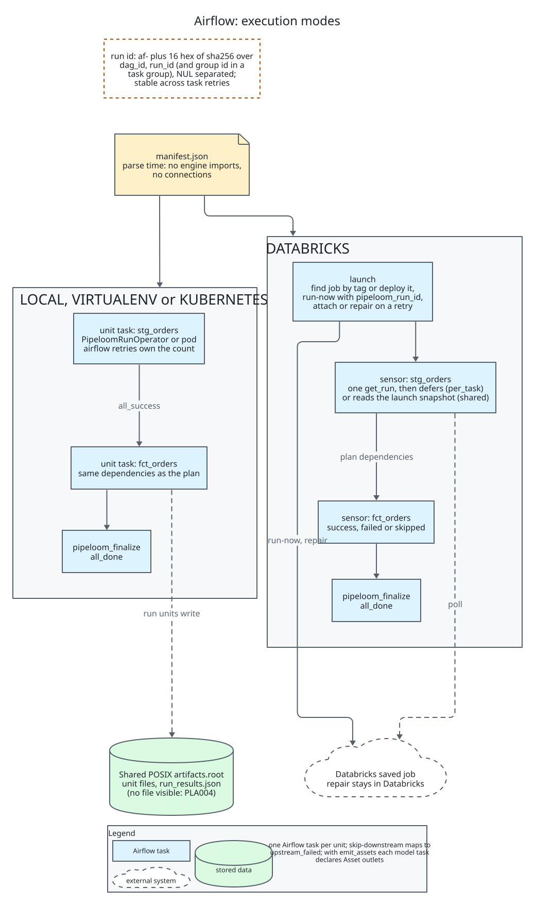

# Airflow

`pipeloom-airflow` turns a compiled plan into an [Apache Airflow](https://airflow.apache.org) 3 DAG
(or a task group inside one): one Airflow task per execution unit, plus a finalize task that closes
the pipeloom run. Four execution modes are supported: `local`, `virtualenv`, `kubernetes` and
`databricks`. The design is in [architecture section 13](../architecture.md#13-the-airflow-plugin)
and ADR-0037 to ADR-0039.

```python
from datetime import datetime

from pipeloom_airflow.config import ExecutionConfig, ExecutionMode, ProjectConfig, RenderConfig
from pipeloom_airflow.dag import PipeloomDag

shop = PipeloomDag(
    dag_id="shop_daily",
    schedule="@daily",
    start_date=datetime(2026, 1, 1),
    project_config=ProjectConfig(
        project_dir="/opt/pipelines/shop",
        manifest_path="/opt/pipelines/shop/target/manifest.json",
    ),
    target="prod",
    render_config=RenderConfig(select=("tag:daily",), group_by="folder", emit_assets=True),
    execution_config=ExecutionConfig(mode=ExecutionMode.LOCAL),
)
```

## Installation

Airflow is not a hard dependency. The extras pull what each mode needs:

| Extra | Adds |
| --- | --- |
| `airflow` | `apache-airflow>=3.2,<4` |
| `kubernetes` | the above and `apache-airflow-providers-cncf-kubernetes>=10.25,<11` |
| `databricks` | the first and `pipeloom-databricks` (not the Databricks Airflow provider) |

Install Airflow the way its project recommends, with a constraint file for your Airflow and Python
versions, so the resolver does not pick versions Airflow was never tested with:

```console
$ AIRFLOW_VERSION=3.3.2
$ PYTHON_VERSION=3.12
$ pip install "pipeloom-airflow[airflow]" \
    --constraint "https://raw.githubusercontent.com/apache/airflow/constraints-${AIRFLOW_VERSION}/constraints-${PYTHON_VERSION}.txt"
```

The floor is Airflow 3.2, the first release with Python 3.14 support. An older or missing Airflow is
reported as PLA005 when the DAG file is parsed, never as an `ImportError`. Installing the plugin
also needs the engine plugins your project uses (`pipeloom[polars]` and so on) on every machine
that runs a unit.

In DATABRICKS mode the **triggerer** must have `pipeloom-airflow[databricks]` installed too, since
the trigger code runs there. The workers that run the launch task need the project files and
`pipeloom-databricks`.

Importing `pipeloom_airflow` imports nothing from Airflow. The DAG classes live in
`pipeloom_airflow.dag` and the configs in `pipeloom_airflow.config`.

## Configuration

Three frozen dataclasses describe a DAG. Paths are strings and must be absolute; they are never
touched at parse time unless a load method reads them.

`ProjectConfig` says where the DAG file reads the project.

| Field | Default | Meaning |
| --- | --- | --- |
| `project_dir` | required | Project directory as the parser sees it. |
| `manifest_path` | `None` | Stable manifest. Required by the `manifest` load method. |
| `vars` | `{}` | Project variables, passed to every unit as `--vars` JSON. |
| `cache_dir` | `None` | Compile cache of the `project` load method. |

`RenderConfig` shapes the task graph.

| Field | Default | Meaning |
| --- | --- | --- |
| `load_method` | `LoadMode.MANIFEST` | `MANIFEST` or `PROJECT`, see below. |
| `select`, `exclude` | `()` | Selectors applied to the plan. A selection that renders no unit is PLA003. |
| `group_by` | `"none"` | `none`, `folder` or `tag`: visual task groups only. Every unit is still one task. |
| `emit_assets` | `False` | Each model task declares an `Asset` outlet. |
| `asset_uri` | `pipeloom://{project}/{target}/{relation}` | Template; placeholders `project`, `target`, `model`, `relation`, `unique_id`. Values are percent-encoded. |

`ExecutionConfig` says how and where units run.

| Field | Default | Meaning |
| --- | --- | --- |
| `mode` | `ExecutionMode.LOCAL` | `LOCAL`, `VIRTUALENV`, `KUBERNETES`, `DATABRICKS`. `DOCKER` is PLA001. |
| `project_dir`, `manifest_path` | those of `ProjectConfig` | Where units execute, when that differs from where the DAG is parsed (a pod, for example). |
| `virtualenv_dir` | `None` | Required by `VIRTUALENV`: a virtualenv created on every worker. |
| `kubernetes` | `None` | Required by `KUBERNETES`: `KubernetesConfig(image, namespace=None, python="python", pod_kwargs={})`. |
| `env` | `{}` | Extra environment for the unit process, or the pod environment. |
| `databricks_conn_id` | `"databricks_default"` | Airflow connection of the workspace. |
| `databricks_pipeline` | `"main"` | Which `deploy` pipeline to run. |
| `databricks_ensure_job` | `False` | Deploy the job from the project when it is missing or stale. |
| `databricks_poll` | `"per_task"` | `per_task` or `shared`, see [Poll modes](#poll-modes). |
| `databricks_poll_interval` | `30.0` | Seconds between polls. |
| `databricks_timeout` | `86400.0` | Seconds any single wait on the job run may last. |

`PipeloomDag` takes `project_config`, `target`, `render_config`, `execution_config`, an optional
`operator_args` mapping that goes to every operator, and the usual `DAG` keywords.
`PipeloomTaskGroup(group_id, ...)` takes the same configs inside an existing DAG. A configuration
error raises `PipeloomAirflowError`, which Airflow shows as the DAG file's import error; warnings go
to the `pipeloom_airflow` logger. `operator_args` may not set `task_id`, `retries`, `retry_delay`,
`trigger_rule`, `outlets`, `execution_timeout` or `deferrable`, nor (in DATABRICKS mode) the
arguments the pipeloom operators set themselves; that is PLA002.

## Load methods

- `MANIFEST` (recommended) reads a stable manifest written by `pipeloom compile --stable`. Parsing
  reads one JSON file and imports no engine. The manifest must be for the same target (PLX107).
- `PROJECT` compiles the YAML project on the parse path. No user code runs (ADR-0003). The result is
  cached on disk, keyed by a hash of the installed pipeloom versions, the target, the variables and
  the path, size and modification time of `pipeloom.yml` and every file under `model_paths` and
  `python_paths`. An entry also stores a fingerprint of the environment variables the plan read, so
  a secret never lands on disk, and a hit needs the same fingerprints. The default directory is
  `pipeloom-airflow-cache` under the system temporary directory; the 8 newest entries per project
  are kept. A cache that cannot be written is PLA006: the project still compiles, only slower.

Airflow 3 parses the DAG file before every task, so a `PROJECT` cache miss costs a compile at task
start-up. Each unit still compiles and checks the plan hash itself, so no worker-local cache path
crosses a process boundary. Prefer `MANIFEST` for large projects.

## Execution modes

| Mode | A unit runs as | Needs |
| --- | --- | --- |
| `LOCAL` | `python -m pipeloom run` in a child process group of the worker, with the worker's interpreter | pipeloom and the engine installed where the worker runs |
| `VIRTUALENV` | the same, with the interpreter of `virtualenv_dir` | the virtualenv on every worker (a missing interpreter fails the task without retry, PLA002) |
| `KUBERNETES` | a pod from `KubernetesPodOperator` | an image with pipeloom; see below |
| `DATABRICKS` | a task of the Databricks job that `pipeloom-databricks` renders | see below |

In LOCAL and VIRTUALENV, killing the task sends SIGTERM to the child's process group and SIGKILL
after the target's cancel grace. Child events are logged line by line to the task log.

### Kubernetes

`image`, `namespace` and `pod_kwargs` go to `KubernetesPodOperator`: volumes, mounts, resources,
service account. `ExecutionConfig.env` becomes the pod environment, and the cancel grace the pod
termination grace period. `project_dir` and `manifest_path` of the execution config are paths
inside the pod. Pods are never deferrable and push no XCom; the keys `cmds`, `arguments`, `image`,
`name`, `do_xcom_push` and `deferrable` in `pod_kwargs` are PLA002.

### Databricks

The DAG has `pipeloom_launch`, one sensor per Databricks task key (with the plan's edges) and a
`pipeloom_finalize` sensor on the job's finalize task. The launch compiles the project on the
worker, checks its plan hash against the DAG's (PLX103), and starts the job run named after the DAG
run. A missing job is PLD007 and a job deployed from other settings is PLD008, unless
`databricks_ensure_job=True` deploys it. A retried or cleared launch finds the same run: it attaches
to it, or repairs it when a task failed. Databricks owns the task retries.

## Artifact store

All units of a run and the finalize task must see one `artifacts.root` directory: unit result files
are how the finalize task learns what happened. pipeloom 0.6 supports a shared POSIX path only; URI
stores such as fsspec are not supported, because create-once files and atomic replace are not
portable across their backends. State stores and filesystem catalogs need shared storage anyway.

| Setup | What `artifacts.root` can be |
| --- | --- |
| LocalExecutor | Any local path. |
| CeleryExecutor | A network mount at the same path on every worker: NFS, EFS or SMB. |
| Kubernetes pods | A ReadWriteMany persistent volume claim, or a CSI object-store mount, given in `pod_kwargs` as `volumes` and `volume_mounts`. |
| Databricks | Not an Airflow concern: the units run inside the job, which has its own artifact location. |

A unit task that Airflow saw succeed, with no attempt file visible under the root, fails the run
with PLA004. That is the sign of a root that is not shared. PLA007 warns when the target's boundary
is not `task`, since each unit runs in its own process.

## Run id

All tasks of a DAG run share one pipeloom run id: `af-` plus the first 16 hex characters of the
sha256 of `dag_id`, the Airflow `run_id` and, inside a `PipeloomTaskGroup`, the group id, joined by
a NUL byte. Joining with NUL keeps two different inputs from hashing alike, and the group id keeps
two groups of one DAG run apart. The id is stable across task retries, so a retry or a clear and
rerun continues the same pipeloom run and increments the unit's attempt. Each unit also records the
DAG id, run id, task id and try number as orchestrator ids.

## Retries

| Mode | Who retries | Rule |
| --- | --- | --- |
| LOCAL, VIRTUALENV | Airflow | The model's `retries` and `retry_delay` become the task's. A unit invocation never retries by itself. Exit 2 fails without retry. Exit 130 retries. Exit 1 fails without retry when the unit's error is permanent and `retry_on` is `transient`; otherwise it retries. |
| KUBERNETES | Airflow | The same counts and delay. `retry_on` is not enforced: Airflow sees only the pod's result, so every failure retries. |
| DATABRICKS | Databricks | Sensors have no retries. A sensor fails once the task's last attempt failed or the run is over. The launch retries twice and attaches to the same run. |

The task execution timeout is the model timeout plus the cancel grace plus 300 seconds, so the core
times a unit out before Airflow does.

## full_refresh

`PipeloomDag` adds the boolean param `full_refresh` (default false) unless you define it. Trigger
the DAG with `full_refresh` set to true to run every incremental model as a full refresh. A value
that is not a boolean is PLA002 at run time. Task groups read the param of the enclosing DAG and
use false when it is missing.

## Assets

With `emit_assets=True`, each model task declares `Asset(name=uri, uri=uri)` outlets, one per
persisted model of the task. The URI comes from `asset_uri`. In DATABRICKS mode the sensor of a task
carries them.

## Finalize and DAG failure

`pipeloom_finalize` runs with trigger rule `all_done` after every leaf task and has one retry. In
LOCAL and VIRTUALENV it reads the states of the unit tasks from Airflow and passes them to
`pipeloom finalize --unit-states`. An attempt file always wins. Without one, a task that
succeeded or failed becomes a failed unit with PLA004, `upstream_failed` becomes skipped, and a
skipped task becomes skipped with `not_run`. The finalize task merges the unit files into
`run_results.json` and **fails the DAG run when the pipeloom run failed** (exit 1, no retry).

In KUBERNETES the finalize pod gets the states inline (`--unit-states-json`). In DATABRICKS the
finalize task of the job does the merge and the `pipeloom_finalize` sensor mirrors its result.

## Databricks connection

The Airflow connection named by `databricks_conn_id` is read by pipeloom itself; the Databricks
Airflow provider is not used, so an existing `databricks_default` connection works.

| Field | Meaning |
| --- | --- |
| Host | Workspace URL. `https://` is added when missing. |
| Password | Personal access token. `extra.token` works as well. |
| Extra `service_principal_oauth` | When true, OAuth machine-to-machine: login is the client id and password its secret. |

No profile, `~/.databrickscfg` or `DATABRICKS_*` variable is read, so a worker's environment cannot
change the authentication. A connection that cannot be used (no host, no token, Azure-only extras)
is PLD010; the message names the connection id and never a value. Secrets are masked in task logs
and a trigger serializes only the connection id.

## Poll modes

| Mode | Behavior | API cost |
| --- | --- | --- |
| `per_task` (default) | The launch returns right after run-now or repair. Each sensor makes one `get_run` call and, with no verdict yet, defers on its own trigger. | One call per waiting sensor per interval. |
| `shared` | The launch defers on one trigger that polls the whole run. Sensors read its final snapshot and make no call. | One call per interval in total, but a task's result shows only when the whole run is over. |

The trigger retries a transient API error (429, 5xx, no answer) up to 5 times in a row, with sleeps
of one, two and then four intervals, and fails the task on an authentication error or when the
retries run out. Every deferral stops after `databricks_timeout` (24 hours by default). A wide DAG
should raise `databricks_poll_interval` or use `shared`.

## Limits

- Airflow does not run on Windows, so neither do the DAG classes. The pure modules (configs,
  rendering, ids) do.
- No `DOCKER` mode: it is PLA001.
- No deferrable pods. `deferrable` is PLA002 for the Kubernetes mode.
- `retry_on` is enforced only in LOCAL and VIRTUALENV.
- The artifact root must be shared (see above). There is no fsspec store.
- The finalize pod takes the unit states inline, capped at 120 KiB because one Linux exec argument
  is limited to 128 KiB. Above that it fails with PLA002; split the project with `select`.
- A DATABRICKS-mode DAG needs the project files on the worker that runs the launch, and each wait
  is bounded by `databricks_timeout`.

## Diagnostics

PLA001 unsupported mode or missing extra, PLA002 invalid configuration, PLA003 the selection renders
no unit, PLA004 a task ended without a unit result, PLA005 unsupported Airflow version, PLA006 the
compile cache is unusable, PLA007 the target boundary is not `task`. See the
[error code reference](../reference/errors.md).


