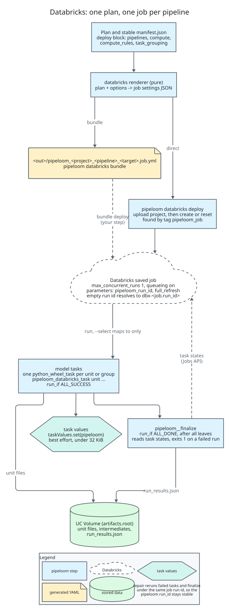

# Databricks plugin

`pipeloom-databricks` deploys a compiled plan as a Databricks job and runs, repairs and finalizes
it from the command line. It also adds a Unity Catalog catalog and a Databricks secret provider.
The design is in [ADR-0035](../adr/0035-databricks-rendering-and-job-lifecycle.md) and
[ADR-0036](../adr/0036-databricks-client-and-connection.md); section 12 of the
[architecture](../architecture.md) has the overview.



## Install

```console
$ pip install "pipeloom[databricks]"       # on your machine, to deploy and run
```

The extra pulls `pipeloom-databricks`, `pipeloom-spark` and `databricks-sdk` (0.50 up to, not
including, 1.0). On a Databricks cluster or serverless environment, install `pipeloom-spark`
without extras: the runtime ships its own pyspark, and a second copy breaks it. The job's own
environment installs pinned versions of the pipeloom distributions for you (see Compute).

## Connection rules

Commands that talk to a workspace pick the connection in this order, and never guess:

1. `--profile NAME`, an option of the `pipeloom databricks` group.
2. A profile you set yourself in `DATABRICKS_CONFIG_PROFILE`.
3. `DATABRICKS_HOST` with `DATABRICKS_TOKEN`, or with `DATABRICKS_CLIENT_ID` and
   `DATABRICKS_CLIENT_SECRET`.
4. Runtime authentication, when `DATABRICKS_RUNTIME_VERSION` is set (inside a Databricks task).
5. Otherwise PLD010.

pipeloom never selects the `DEFAULT` profile of `~/.databrickscfg`, and without a profile the
SDK is told that no config file exists. The group option comes before the command:

```console
$ pipeloom databricks --profile prod-workspace deploy --target prod
```

`deploy --dry-run` and `bundle` connect to nothing.

## The deploy block

A target gets a `deploy` block of kind `databricks`. It needs a shared state store (for example
`table`) and an absolute `artifacts.root` on a volume, because the tasks of one run share both.

```yaml
targets:
  prod:
    engine: {kind: spark}
    catalog: {kind: unity, catalog: main}
    state: {kind: table, table: ops._pipeloom_state}
    artifacts: {root: /Volumes/main/ops/pipeloom}
    deploy:
      kind: databricks
      pipelines: {main: {}, daily: {select: ["tag:daily"]}}
      compute:
        default: {kind: serverless, environment_version: "5"}
        big:
          kind: job_cluster
          new_cluster: {spark_version: "16.4.x-scala2.12", node_type_id: "Standard_D8ds_v5", num_workers: 4}
      compute_rules: [{select: ["tag:heavy"], compute: big}]
      task_grouping: none
      settings: {schedule: {quartz_cron_expression: "0 0 6 * * ?", timezone_id: "UTC"}}
```

| Key | Meaning |
| --- | --- |
| `pipelines` | One job per entry. `select` and `exclude` take selectors; empty means the whole plan. Default: one pipeline `main`. |
| `compute` | Named computes: `serverless` or `job_cluster`. |
| `default_compute` | The compute no rule matches (default `default`). |
| `compute_rules` | Selector rules; the first rule that matches a model wins. |
| `task_grouping` | `none`, `by_tag` or `by_folder`. |
| `workspace_root` | Where a direct deploy uploads the project. Default `/Workspace/Users/<you>/.pipeloom`. |
| `settings` | Job settings passed through (schedule, notifications, `run_as`, tags, ...). |

A job is named `pipeloom_<project>_<pipeline>_<target>`. Rendering is pure and byte-for-byte
deterministic, so a rendered job can be reviewed and diffed. A pipeline job runs only its own
units: an upstream model in another pipeline is read from its persisted output, so schedule that
pipeline first.

`settings` cannot set what pipeloom owns: `tasks`, `job_clusters`, `environments`, `parameters`,
`max_concurrent_runs`, `queue`, `format`, `git_source`, `deployment`, `name`, or a tag that starts
with `pipeloom_`. A `${secret:...}` reference in the block is refused. All of these are PLD004.

## Compute and compute rules

A serverless compute becomes one job environment named `pipeloom_<compute>`. Its
`environment_version` is a string from 2 to 6 (default "5", Python 3.12); version 1 runs
Python 3.10, below the floor, and is PLD004. A job holds at most 10 environments.

`dependencies` lists pip requirements. Unset, the environment installs pinned distributions:
`pipeloom`, `pipeloom-databricks` and every plugin in the plan, as `name==version`, sorted. Set
it to install from somewhere else, for example wheels on a volume. A `job_cluster` compute
becomes a shared job cluster, with `libraries` defaulting to the same pins from PyPI.

`compute_rules` choose the compute per model. A rule with no matching model is the warning
PLD005. All models of one task group must resolve to the same compute (PLD004).

Each model keeps its own `retries`, `retry_delay` and `timeout`: they become `max_retries`, the
retry interval and `timeout_seconds` (the model timeout plus the cancel grace plus 300 seconds).
Databricks retries any failure, so `retry_on: transient` cannot be enforced there. Serverless tasks
are rendered with `disable_auto_optimization: true`: serverless auto-optimization would otherwise
retry a failed task on top of `max_retries`, so a model with `retries: 0` would still run twice.

## Task grouping

With `task_grouping: none` every unit is one task, named by its unit id. `by_tag` groups models by
their first tag (`tag_<tag>`, or `tag_untagged`) and `by_folder` by the folder of the model file
(`dir_<folder>`, or `dir_root`). Grouping applies whenever it is set, so the job's shape does not
change when the project grows. A group runs its models with the in-process scheduler. Groups that
wait on each other in a cycle are PLD003. Task keys are sanitized to `[A-Za-z0-9_-]`; a key above
100 characters, or one that collides, gets a short hash suffix.

## Bundle and direct deploy

Two ways to create the same job.

**Bundle.** `pipeloom databricks bundle --target prod --out resources` writes one job file and one
stable manifest per pipeline into a Declarative Automation Bundle. The output folder must lie
inside the bundle, next to `databricks.yml`, and the job files must be in its `include`. Paths use
`${workspace.file_path}`. `--check` writes nothing and exits 1 when a file is stale. Running
`databricks bundle deploy` stays your step.

**Direct deploy.** `pipeloom databricks deploy --target prod` uploads the project and creates or
resets one job per pipeline. The job is found by its `pipeloom_job` tag (two matches are PLD006).
The upload is content addressed, under `<workspace_root>/<project>/<pipeline>/<target>/<hash>`,
and holds `pipeloom.yml`, the model files and the `*.py` files below `python_paths`. Other files
below `python_paths` are not uploaded, so a Python model that reads a file next to it works
locally and not on Databricks; keep such data in a table or a volume. Notebooks and files above
10 MB are refused (PLD012). When the settings hash tag already matches, deploy changes nothing.
`reset` overwrites edits made in the Databricks UI; use `settings` instead. `--dry-run` prints
the settings as JSON and connects to nothing.

## Run

```console
$ pipeloom databricks run --target prod --pipeline daily
```

`run` starts the deployed job with `run-now`. A missing job is PLD007, and a job whose settings
differ from what the project renders now is PLD008, unless you pass `--ensure`, which deploys
first. The command prints one JSON line with the job id, the job run id, the run id and the run
page URL.

- `--select` and `--exclude` choose units. Their tasks plus finalize run (`only`); the others are
  excluded. A group that is partly selected runs whole, with the warning PLD015. A selection that
  matches nothing is exit 2.
- `--run-id RID` names the run and makes the start idempotent. Without it the run id is
  `dbx-<job run id>`. `--full-refresh` is passed to the tasks.
- `--ephemeral` uploads the project and submits a one-time run with no saved job. It is for
  development: serverless compute only, and the same 1,000-task limit.
- `--wait` (the default) polls every 15 seconds, prints task transitions, then lists the failed
  units from `run_results.json` and exits 1 unless the run succeeded. `--no-wait` returns after
  the start. `--timeout SECONDS` (default 24 hours) stops the wait with exit 1; the run keeps
  going.

## Repair

```console
$ pipeloom databricks repair --target prod --pipeline daily --run-id RID
```

Name the run with `--run-id` (the pipeloom id) or `--job-run-id` (the Databricks id), exactly one.
Repair reruns the tasks that failed, timed out, were cancelled or were skipped, plus finalize. The
run keeps its run id, and each rerun unit writes the next attempt: the repair passes the run's job
parameters again, since without them `{{job.parameters.pipeloom_run_id}}` would resolve to its empty
default and start a new pipeloom run. A run that is still active is
PLD014. With nothing to repair the command says so and exits 0. `--wait`, `--no-wait` and
`--timeout` work as in `run`.

## Finalize and task states

Every job ends with the task `pipeloom__finalize`. It depends on every leaf task, runs with
`run_if: ALL_DONE`, and calls `pipeloom finalize`, which merges the unit files into
`run_results.json` and closes the run.

A task that dies, times out or is cancelled can leave no attempt file. Finalize therefore reads
how each task ended from the Jobs API and hands core the state of every unit without an attempt:

| Task state | Unit state |
| --- | --- |
| EXCLUDED, DISABLED | excluded (no row); serverless reports a task left out by `only` as DISABLED |
| UPSTREAM_FAILED, UPSTREAM_CANCELED | skipped, reason `upstream_failed` |
| CANCELED, TIMEDOUT | cancelled |
| FAILED | failed, with PLD011 and the termination message |

If the API cannot be read, finalize prints one warning and judges by the attempt files; units with
neither get `not_run`, which does not fail the run. A job run's result comes from its leaf tasks,
so a succeeding finalize would hide a failure: finalize exits 1 when the run failed. A one-time
run has no job run id in its parameters, so it gets no task states.

## Task values

After a unit task, the wrapper sets the task value `pipeloom`: the run id, the run status and,
per unit, status, attempt, rows written, duration, target version, error code and warning count.
Values above 32,768 bytes lose units from the end and carry `truncated: true`; Databricks caps a
value at 48 KiB. Task values are documented for notebooks only, so setting one is best effort:
a failure prints one line on stderr and never changes the exit code.

## Secrets provider

`${secret:databricks/<scope>/<key>}` in plugin options reads a Databricks secret scope at run
time, with the connection rules above (no profile is chosen, so it works inside a job). The value
is masked like any resolved secret. A bad path, a missing connection or an API error is PLX109,
naming the path and never the value.

## Unity Catalog

`catalog: {kind: unity, catalog: main}` works with the Spark engine only. Tables and views are
addressed as `` `catalog`.`schema`.`name` ``; the option fills in the catalog when the target's
naming leaves it empty. A schema is created only when it does not exist yet, so a principal
without `CREATE SCHEMA` can write to an existing one.

## Limits and unconfirmed facts

- A job has at most 1,000 tasks, finalize included (PLD001; set `task_grouping` or split the
  pipelines). `runs/submit` shares the limit, so PLD002 stays reserved and is never emitted.
- A task value is at most 48 KiB; pipeloom stays under 32 KiB.
- Tasks run the plugin wrapper `pipeloom_databricks_task`, a `python_wheel_task` entry point, in
  the task's own process, so an existing Spark session is reused. When none is active on a
  Databricks runtime, the Spark engine attaches with `builder.getOrCreate()` and no conf.
- An unresolved `{{...}}` in a task parameter stops the task with PLD013.

Some behaviors cannot be confirmed from public documentation, so the code guards them and a
manually dispatched workflow, `databricks-live`, checks them against a real workspace (see
CONTRIBUTING). Until it has passed for your runtime, treat these as unconfirmed:

- dynamic value references such as `{{job.run_id}}` inside wheel task parameters;
- an empty parameter default resolving to `dbx-<job run id>`;
- `only` with an `ALL_DONE` finalize whose dependencies are excluded;
- `job.start_time` staying the same across repairs;
- `disable_auto_optimization` stopping the serverless automatic retry, in a job and in a one-time run (`--ephemeral`);
- `os.link` and `os.replace` on `/Volumes` (attempt files fall back to an exclusive open);
- a Spark session being available in a wheel task;
- task values set from a wheel task (not checked by the workflow today);
- workspace import format `AUTO` keeping a plain `.py` or `.yml` as a file.
